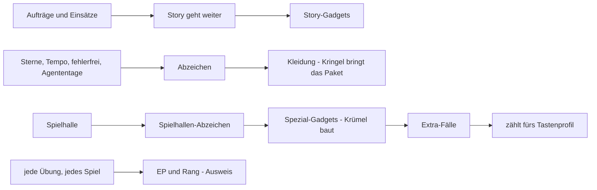

# Belohnungen und Ausrüstung – Konzept

Stand 26.10.2026 · abgestimmt, ergänzt [Story und Agenten-Chat](story.md) · drei Review-Runden eingearbeitet

## Ziel

Die Ausrüstung soll Teil der Geschichte werden: Mit bestimmten Dingen kann man Fälle lösen. Dabei gilt die Grundregel des Spiels weiter: **Niemand bleibt stecken.** Ein automatischer Test muss das beweisen.

Gleichzeitig wird das ganze Belohnungssystem glattgezogen. Heute gibt es EP, Ränge, Sterne, Abzeichen, Garderobe, Spielhalle und Serie. Jedes Teil funktioniert für sich, aber die Teile hängen kaum zusammen. Warum es für 60 Anschläge pro Minute ausgerechnet Leggings gibt, erklärt niemand.

## Befund heute

| Element | Was es tut | Problem |
| --- | --- | --- |
| EP und Rang | misst Fleiß, sechs Ränge | taucht in der Story nicht auf |
| Sterne | Qualität je Auftrag | gut, lädt zum Wiederholen ein |
| Abzeichen | 17 Stück in vier Kategorien | gut; manche schalten Kleidung frei, ohne erkennbaren Zusammenhang |
| Garderobe | Aussehen, Teile über Abzeichen | rein kosmetisch, Krümel kündigt neue Teile an |
| Spielhalle | zwei Spiele, Bestwerte, wenig EP | Abwechslung, aber ohne Folgen für die Story |
| Agententage (früher Serie „Tage am Stück“) | Tage mit Training, sinkt nie | gut |

## Die Lösung in einem Satz

**Gadgets gibt es in der Geschichte. Kleidung und Farben bringen dein Können und dein Rang – und manchmal schenkt dir jemand aus der Geschichte etwas. Die Spielhalle bringt Spezialausrüstung für Extra-Fälle. Und jede Belohnung überreicht dir eine Figur.**

Seit Oktober 2026 ist von Anfang an nur frei, womit sich ein Kind selbst darstellt (Haut, natürliche Haar- und Augenfarben, Alltagsfrisuren für jeden Haartyp, eine Brille, je zwei Teile). Alles andere wird freigespielt; die Zuordnung steht unten und in `src/content/wardrobe.ts`.

So kann man es auch einem Kind erklären. Krümel sagt es im Spiel einmal genau so, in der Szene, in der er den Buchstabenkescher übergibt.

## Zwei Arten von Dingen

| Art | Beispiele | Woher | Wofür | Anziehen nötig? |
| --- | --- | --- | --- | --- |
| **Gadgets** (im Agentenkoffer) | Dechiffrierscheibe, Beweisfach, Buchstabenkescher, Stethoskop | Story oder Spielhalle | Fälle lösen | nein, Besitzen reicht |
| **Kleidung** (Garderobe) | Strickjacke, Agentenstiefel, Agentenbrille | Abzeichen | Aussehen | ja, aber nur für den Look |

Später kommen **Fundstücke** an einer **Fallwand** dazu (Goldstaub, Feder, halbes Foto). Das ist eine Pinnwand mit den Hinweisen des Falls, wie bei Gossip Harbor. Für den ersten Schritt brauchen wir sie nicht.

**Gadgets mit sichtbarem Inhalt:** Das Beweisfach zeigt im Koffer seine Beweisstücke als gleich große Kacheln (das Bild wird eingepasst, die Karte bleibt so groß wie die anderen). Ein Klick öffnet einen Betrachter (Fenster mit festem Bildrahmen, Name, Satz, Blättern mit ◀ ▶ und Pfeiltasten, Esc schließt); mit offener Fallakte führt „Zur Fallakte“ dorthin. So bleibt der Koffer auch mit vielen Stücken ruhig. Die Stücke sind Inhaltsdaten am Gadget (`pieces` in `content/items.ts`): ein Stück erscheint, sobald seine Szene im Story-Log steht (`piecesFound`). Es wird nichts gespeichert, und es gibt keinen „Neu“-Hinweis – Krümel sagt es im Chat.

**Warum Gadgets nicht angezogen werden müssen:** Müsste man ein Gadget erst ausrüsten, gäbe es versteckte Stolpersteine („Warum geht das nicht?“ – weil das Stethoskop nicht ausgerüstet war). Für 10-Jährige bringt das keinen Spielspaß, nur Verwirrung. Darum gilt: Was im Koffer ist, hat man dabei. Agenten nehmen immer den ganzen Koffer mit.

**Gadgets schalten keine Bedienung frei.** Funk, Spielhalle, Garderobe und Einstellungen sind immer da, wo sie heute sind. Gadgets sind nur Story. Der Flow-Chip in Akt 3 und die Blindflug-Brille in Akt 7 sind Story-Namen für Einstellungen (die Blindflug-Brille gibt dem Knopf „Tastatur ausblenden“ seinen Namen „Blindflug“ und Krümels Satz nach der Runde seine Worte); ob es die Einstellung schon vorher gibt, bleibt davon unberührt.

## Wo Gadgets gebraucht werden – und wo nicht

Die wichtigste Regel: **Die Hauptgeschichte verlangt nur Gadgets, die sie selbst vorher verschenkt hat.** Damit kann man in der Hauptgeschichte nie stecken bleiben. Gadgets aus der Spielhalle öffnen nur Zusätzliches.

| Stelle | Darf ein Gadget verlangen? | Beispiel |
| --- | --- | --- |
| Haupt-Szene (Stufe, Abschluss, Einsatz) | nur Story-Gadgets, die eine frühere Haupt-Szene gegeben hat; die Szene erwähnt sie, eine Hürde sind sie nie | „Hol die Dechiffrierscheibe raus!“ |
| Extra-Fall | ja, das ist ihr Zweck | „Kringels Briefkasten“ braucht das Stethoskop |
| Antwort in einer Szene | nur als **zusätzliche** Antwort; mindestens eine geht immer ohne | **[Lupe]** „Ich schau mir das Foto genauer an.“ → ein Extra-Hinweis |

**Besitz entsteht beim Auslösen, nicht beim Lesen.** Eine Szene gilt als ausgelöst, sobald sie fällig wird, also nach der Runde. Ob das Kind sie liest oder den Chat mit Esc schließt, ist egal: Das Gadget ist im Koffer. Die Szene bleibt im Funk zum Nachlesen.

### Extra-Fälle

Extra-Fälle sind kleine Fälle neben der Hauptgeschichte. Jeder besteht aus:

1. einer Chat-Szene, die den Fall eröffnet;
2. **einer Tippübung** im Gewand des Falls: „Blasen fangen“, „Klickfolge horchen“. Der Text kommt wie bei einem Training aus dem Textgenerator (`generateText` mit Fokus auf schwachen Tasten) und nutzt alle Tasten bis zum aktuellen Auftrag. Die Lösung des Falls, etwa ein Satz in einer Seifenblase, wird nur angezeigt, nicht getippt. Darin dürfen dann auch Buchstaben stehen, die man noch nicht kann;
3. einer Abschluss-Szene mit EP wie für eine Übung und **einem Gadget, das zum Fall passt** (beim ersten Lösen).

Technisch ist ein Extra-Fall ein Durchgang mit einer Trainingsrunde (`kind: 'training'`) für den aktuellen Auftrag. Er zählt deshalb auch für Abzeichen, die Übungen zählen, und kann Stufen-Szenen auslösen, weil die Werte gestiegen sind. Für „geschafft“ zählt er nicht.

Ein Extra-Fall wird angeboten, sobald man das passende Gadget hat und weit genug im Kurs ist. Im HQ steht er als Karte „Extra“ auf der Missionskarte. Krümel meldet ihn im Chat an.

**Sichtbar vs. spielbar:** Sobald der Startauftrag begonnen ist (und eine Vorbedingungs-Szene ausgelöst), ist der Fall **sichtbar** (`caseVisible`); **spielbar** ist er erst mit dem Gadget (`caseAvailable`). Fälle ohne Gadget stehen im HQ als gesperrte Karte (Text „gesperrt“, kein Knopf, kein Schloss-Symbol) mit dem Weg zum Gadget („Braucht: Stethoskop. Hol dafür das Abzeichen „Tresorknacker“: …“). Spielbare Karten stehen zuerst. Vor dem Startauftrag bleibt ein Fall überall unsichtbar (kein Spoiler). Solange der Einsatz des Moduls weder geschafft noch je versucht wurde, sagt die offene Karte: „Tipp: Löse ihn vor dem Einsatz – das Gadget daraus hilft dir dort.“ Im Koffer nennt ein fehlendes Fall-Gadget den Fall, sobald dieser sichtbar ist. Wiederholen geht und gilt dann als Training.

**Doppelter Nutzen:** Die Tippübung zählt fürs Tastenprofil wie ein Training. Ein Kind, das an G und H hängt, kann statt der fünften gleichen Übung einen Extra-Fall spielen und kommt trotzdem voran. Das hilft direkt gegen „Ich muss schon wieder dasselbe machen“.

Für „geschafft“ zählen weiter nur Übungen des Auftrags; die Regel „mindestens zwei Übungen“ bleibt.

**Was Extra-Fälle erzählen dürfen:** nur Zusätzliches. Was wichtig ist, steht in der Hauptgeschichte (siehe story.md, A4). Verweist die Hauptgeschichte später auf einen Extra-Fall („Juna fragt nach ihrer Liste“), braucht sie immer auch eine Variante für „nicht gespielt“.

## Wer dir etwas gibt

Jede Belohnung kommt von einer Figur, im Chat und mit einem Satz dazu. Nackte „Freigeschaltet!“-Meldungen gibt es nicht mehr.

| Belohnung | Überbringer | Beispiel |
| --- | --- | --- |
| Story-Gadget | Ada oder Krümel in der Szene | **Ada:** Nimm die Dechiffrierscheibe. Die hat schon Frau Hubbel gehört. Meiner Lehrerin. |
| Spielhallen-Gadget | Krümel, der Bastler | **Krümel:** Aus deinen Tresor-Punkten habe ich etwas gebaut: ein Stethoskop! Damit hörst du Schlösser flüstern. |
| Kleidung (Abzeichen) | **Herr Kringel bringt ein Paket**, Krümel meldet es im Chat | **Krümel:** Postbote Kringel war da. Er sagt: „Paket für {vorname}! Von … der Backstube? Ich bin doch gerade IN der Backstube.“ Dazu der Knopf „Zur Garderobe“. |
| Strickjacke (3 Agententage) | Ada hat sie gestrickt | **Ada:** Drei Agententage schon. Dafür hab ich dir was gestrickt. Sag nichts zur Farbe. |
| Rang-Aufstieg | Ada; Krümel druckt den Ausweis neu | **Ada:** Beförderung! Ab heute bist du Anwärterin (bzw. Anwärter – alle Ränge gibt es in beiden Formen). **Krümel:** Ratter, ratter! Neuer Ausweis! |

Kleidung kommt per Post, Herr Kringel bringt sie. Kringel weiß nichts von der ZEHN und spricht nie selbst im Chat; Krümel zitiert ihn.

**Wer im Chat schreibt:** Paket-Meldungen und gebaute Gadgets kommen von Krümel im Krümel-Chat. Was Ada selbst überreicht (Strickjacke, Agentenbrille, Rang-Aufstieg), kommt in ZEHN intern, denn Erwachsene schreiben nicht privat.

**Wo die Meldungen auftauchen:** Abzeichen gibt es nach Übungen, Einsätzen, Spielhalle und Hintertür. Die Paket-Meldung ist eine Szene mit dem Auslöser „Abzeichen“; sie kommt in Krümels Chat und erscheint als „Funk: neu“. Sie ersetzt die heutige Garderobe-Ankündigung im HQ.

## Das ganze System auf einen Blick

| Element | Rolle | Was sich ändert |
| --- | --- | --- |
| EP und Rang | misst Fleiß | Ada gratuliert im Chat, der Ausweis wird neu gedruckt |
| Sterne | Qualität je Auftrag | bleibt |
| Abzeichen | Meilensteine | bleiben; jedes hat höchstens **eine** Belohnung, Kleidung oder Gadget |
| Garderobe | Aussehen | Ankündigung kommt als Paket von Kringel |
| Agentenkoffer | Gadgets | **neu**, zweiter Reiter neben der Garderobe |
| Spielhalle | Abwechslung | bringt Spezial-Gadgets, damit Extra-Fälle |
| Extra-Fälle | Abwechslung mit Story | **neu**, zählen fürs Tastenprofil |
| Agententage | Dranbleiben ohne Verlustangst | bleibt; Belohnung Kleidung |

**Bewusst nicht:** keine Währung, kein Laden, keine Zufallsbelohnungen, keine Zeitlimits. Jede Belohnung hat genau eine nachvollziehbare Ursache.

## Akt 1 konkret

### Story-Gadgets

| Gadget | Bekommt man | Wird erwähnt |
| --- | --- | --- |
| Dechiffrierscheibe | Auftrag 3, Briefing („Die hat schon Frau Hubbel gehört.“) | beim Entschlüsseln der Karte (Briefing Auftrag 3) |
| Beweisfach | Auftrag 5, Stufe 75 % (Krümel steckt die Feder hinein) | nach dem Einsatz: Krümel legt das halbe Foto hinein (und sagt es); später die Fallwand |

Agentenfunk und Agentenausweis sind keine Gadgets, sondern Story-Bilder im Chat. Den Funk gibt es immer.

### Spezial-Gadgets aus der Spielhalle

| Gadget | Abzeichen (gibt es schon) | Krümel sagt | Öffnet Extra-Fall |
| --- | --- | --- | --- |
| Buchstabenkescher | Spielkind (einmal gespielt) | „Damit fängst du Buchstaben, die herumfliegen. Kommt öfter vor, als man denkt.“ | Der Seifenblasen-Brunnen |
| Stethoskop | Tresorknacker (15 Codes) | „Damit hörst du Schlösser flüstern.“ | Kringels Briefkasten |
| Rotlicht-Lampe | Regenmacher (150 Punkte) | „Macht unsichtbare Tinte sichtbar. Gegen Monster unterm Bett hilft sie nicht. Hab's probiert.“ | Junas geheime Liste |

Das erste Gadget gibt es schon fürs einmalige Spielen, damit auch Kinder, die in der Spielhalle nicht gut sind, einen Extra-Fall erleben.

### Level und Medaillen in der Spielhalle

Jede Runde soll mit einem Erfolg enden, nicht nur mit dem Verlieren. Der Ablauf liegt in gemeinsamen Bausteinen (`domain/arcade/levels.ts`), die Schwellen und Wörter je Spiel in `content/arcadeGames.ts`:

- **Level in der Runde:** Der Regen läuft in Wellen (Welle n hat 8 + 2n Tropfen, das Tempo steigt je Welle um eine Stufe, 2 s Pause mit Bonus 10 × n). Im Tresorknacker ist jeder geöffnete Tresor ein Level. Beide jubeln kurz, wenn ein Level geschafft ist.
- **Medaillen über Runden:** Regen Bronze ab Welle 3, Silber ab 6, Gold ab 9; Tresor Bronze ab 1, Silber ab 2, Gold ab 3 geöffneten Tresoren. Das Ergebnis zeigt die Medaille der Runde und das nächste Ziel; die HQ-Karte zeigt die beste Medaille. Gespeichert werden je Spiel höchstes Level und beste Medaille.
- **Startlevel:** Von 1 bis zum höchsten schon geschafften Level wählbar (Pfeiltasten). Die beim Start übersprungenen Level zählen als geschafft (man hat sie schon erreicht): Wer bei Welle 4 startet und gleich verliert, hat Welle 3 und damit Bronze; wer Welle 4 schafft, hat Welle 4. So endet auch eine Runde auf höherem Level mit einem Erfolg.
- **Gold-Abzeichen** (`regen-gold`, `tresor-gold`) haben keine Szene und keinen Gegenstand und ändern nichts an der Geschichte. Die Abzeichen Spielkind, Regenmacher und Tresorknacker bleiben unverändert.

### Extra-Fälle in Akt 1

**Der Seifenblasen-Brunnen** (ab Auftrag 3 – ein Vorbote, bevor TIPPNIX in Auftrag 5 eröffnet; braucht den Buchstabenkescher)
Junas Gerücht stimmt: Der Brunnen am Markt spuckt Seifenblasen, und in jeder schwebt ein Buchstabe. Man fängt sie ab (Tippübung), zusammen ergeben sie: „TIPPNIX – BALD AUCH IN IHRER STADT“.
**Krümel:** Werbung? In unserem Brunnen? Was ist überhaupt TIPPNIX?
**Ada:** Nie gehört. Klingt nach Ärger mit Lollis.
Das ist ein zusätzlicher Vorbote; die Hauptgeschichte stellt TIPPNIX in Auftrag 5 ohnehin vor.

**Kringels Briefkasten** (ab Auftrag 3, braucht das Stethoskop)
Krümel meldet sich live vom Markt in ZEHN intern: Herr Kringel hat sich aus seinem eigenen Briefkasten ausgesperrt und ist todunglücklich. Man horcht das Buchstabenschloss ab und tippt die Klickfolge (nur Buchstaben – Zahlen kommen erst in Akt 6). Drinnen liegt ein Briefumschlag: „Für Ada“.
**Krümel:** Kringel ist knallrot. Röter als Adas Ofenhandschuh.
- **[Mut machen]** „Sag ihm, er soll ihn ihr einfach geben!“ → **Krümel:** Kringel sagt: „Morgen. Ganz bestimmt. Vielleicht.“
- **[Nicht lesen]** „Sag ihm, wir lesen den nicht.“ → **Krümel:** Kringel sagt, du bist ein Ehrenmensch.

**Krümel:** Er schenkt dir zum Dank seine Lupe. „Für Briefmarken. Und für Detektive.“

Später kommt als Nebenszene in ZEHN intern: **Ada:** Kringel hat mir ein Gedicht gebracht. Es reimt sich nicht. Ich hab's trotzdem aufgehoben.

**Junas geheime Liste** (ab Auftrag 6, erst nachdem Juna dir zum ersten Mal geschrieben hat; braucht die Rotlicht-Lampe; Abschluss im Juna-Chat)
Juna hat am Kiosk einen Zettel verloren, scheinbar leer. Unter Rotlicht steht: „VERDÄCHTIGE: 1. Kringel (Feder!) 2. WER klebt nachts Buchstaben zurück??? 3. {vorname} (geht dauernd in den Keller)“. Platz 2 folgt aus Junas eigenem Beitrag nach Auftrag 5 („Über Nacht! Wer war das?!“); vom Zylinder weiß sie vor dem Einsatz noch nichts.
**Krümel:** Du stehst zweimal drauf. Auf Platz 2 und auf Platz 3. Ich bin so stolz.
Im Intro sagt Krümel: „Vielleicht steht drauf, wem er gehört. Rotlicht an! 🔦“ – und Ada: „Und danach bringst du ihn zurück. Fremde Sachen behält man nicht.“ (Ada erlaubt nicht, fremde Zettel zu lesen.) Wie man ihn zurückgibt, darf man wählen:
- **[Einfach zurück]** „Hier, den hast du verloren.“ → **Juna:** … Hast du den GELESEN?! Egal. Danke.
- **[Mit Witz]** „Hier. Und schreib mich auf Platz 1.“ → **Juna:** HA. Okay, das war gut. 😂

**Juna:** Behalt das Walkie-Talkie, das war mit im Umschlag. Dann kann ich dich nerven.

In Akt 2 reagiert Juna darauf, mit einer Variante für Kinder, die den Fall nicht gespielt haben.

### Extra-Fall in Akt 3

**Die verschluckte Durchsage** (ab Auftrag 2 nach dem Briefing; braucht wieder den Buchstabenkescher). Ortruds Zuglautsprecher verliert Buchstaben, man fängt sie im Fahrtwind (Tippübung mit den schwächsten Tasten bis Auftrag 2). Lösung: die ganze Durchsage, „Nächster Halt: Markt. Buchstaben bitte liegen lassen. Die gehören der Stadt. – O.“ Belohnung: das **Tunnel-Megafon**, aus dem Lautsprecher gebaut; es zahlt sich nach dem Einsatz aus (`a3-exam-after`, als Zusatz-Antwort). Lupe, Fernglas, Verkleidungskoffer und Blasenwerfer haben in den Fall-Szenen je eine Zusatz-Antwort. Der Strang `durchsage` reagiert mit einer Nebenszene, mit Variante für Kinder, die den Fall nicht gespielt haben. Der Wortlaut steht in `content/story/akt3/` (Quelle der Texte: Drehbuch Akt 3, liegt nicht im Repository).

### Fälle der Woche (Training)

Nach dem Finale gibt es fünf kleine Extra-Fälle ohne Gadget und ohne Gabe: Pits Preisliste (Juna), Hupfs Dankesbrief (Hilde Hupf), Die Elster zieht um (Juna), Die Nachbarstadt fragt (Hupf) und Maschine 4 fragt (Tippi). Sie kommen **der Reihe nach**: der erste, sobald die Funk-Nachricht nach der zweiten Tippstunden-Runde da ist (`afterScene`), jeder weitere, sobald der vorige gelöst ist (`afterCase`). Es gibt weder `needs` noch `gives`; der Auftrag ist der letzte von Akt 7. Krümel kündigt jeden Fall mit Bild an, Intro und Outro laufen in ZEHN intern, im Outro steht die Lösung als Karte. Gespielt wird eine Trainingsrunde im Gewand des Falls; sie zählt wie ein Training (Sterne, EP, Tastenprofil), aber nicht als Tippstunden-Runde. „Der Woche“ ist nur ein Name, es gibt keinen Kalender und keine Wartezeit. Die Texte stehen in `content/story/training/` (Quelle der Texte: Drehbuch Training, liegt nicht im Repository).

### Was die Extra-Fälle einbringen – und wo es sich auszahlt

Jeder Extra-Fall bringt ein Gadget, das aus dem Fall heraus Sinn ergibt. Alle zahlen sich **beim Einsatz** ihres Akts oder gleich danach aus, als zusätzliche Antwort. Wer Extra-Fälle gespielt hat, erlebt den großen Moment also ein bisschen reicher. Wer nicht, verpasst nichts von der Handlung.

| Extra-Fall | Gadget | Warum gerade das | Zahlt sich aus |
| --- | --- | --- | --- |
| Seifenblasen-Brunnen | **Blasenwerfer** | Krümel baut ihn aus dem Rest von Ottis Werbemaschine. „Für Ablenkungsmanöver. Und Geburtstage.“ | Einsatz-Intro: **[Blasenwerfer]** „Ich lenk ihn mit Seifenblasen ab!“ → **Baron:** Seifenblasen? Wie … entzückend. Und wie lästig! |
| Kringels Briefkasten | **Kringels Lupe** | Kringel schenkt sie zum Dank: „Für Briefmarken. Und für Detektive.“ | Szene nach dem Einsatz, beim halben Foto: **[Lupe]** „Ich schau mir das genauer an.“ → **Krümel:** Neben MEHL ist was gekritzelt. Ganz klein: ein B. |
| Junas geheime Liste | **Walkie-Talkie** | lag mit der Liste im Umschlag; Juna schenkt es dir, als du den Zettel zurückbringst | Szene nach dem Einsatz: **[Funken]** „Ich funk mal Juna an.“ → **Juna:** WAS war das um 12?! Erzählst du's mir? … Nein? Na gut. Noch nicht. |
| Die verschluckte Durchsage (Akt 3) | **Tunnel-Megafon** | Krümel baut es aus Ortruds altem Zuglautsprecher. „Damit hört dich der ganze Untergrund.“ | Szene nach dem Einsatz (`a3-exam-after`): Zusatz-Antwort **[Megafon]** |

Ab Akt 2 werden Lupe, Walkie-Talkie und Blasenwerfer weiter gebraucht, vor allem in neuen Extra-Fällen. Das Walkie-Talkie wird wichtig, wenn Juna zur ZEHN kommt. In der Hauptgeschichte bleiben sie immer zusätzliche Antworten, nie Bedingung.

### Kleidung in Akt 1 (Abzeichen → Paket von Kringel)

**Wer etwas bekommen hat, behält es.** Zuordnungen für Neues dürfen sich ändern (Belohnungstakt, Oktober 2026; Belohnungsplan, November 2026): Ein Abzeichen ist selbst eine Belohnung und bringt nicht immer ein Teil. Akt 1 bringt höchstens **neun** freispielbare Dinge (Teile und Farbpakete). Die übrigen Teile sind für spätere Akte zurückgelegt (siehe „Plan fürs ganze Spiel“): ihr Paket ist stillgelegt (`retired`, Inhaltsversion 6 und 7), das Abzeichen bleibt. Wer das Abzeichen oder das Paket schon hat, behält das Teil; wer das Abzeichen vor der Stilllegung verdient, das Paket aber noch nicht bekommen hat, holt es beim Laden nach (alte Stände mit Version 6). Die Garderobe zeigt bei zurückgelegten Teilen „Kommt in einem späteren Akt“. Teile, die früher frei waren und jetzt freigespielt werden (z. B. Polo, bunte Haarfarben), bleiben wählbar, solange ein Spielstand sie trägt. Jedes Teil bekommt einen Satz Begründung im Paket.

Die neun Dinge in Akt 1:

| Quelle | Ding | Zettel im Paket |
| --- | --- | --- |
| Geschichte (Auftrag 2, 3, 5) | Polo, Stirnband, Weste | Satz der Figur, die es überreicht |
| Tastsinn | Krempelhose | „Backstubenlook. Damit fällst du bei Ada nicht auf.“ |
| Entschlüsselt | Hornbrille | „Für Leute, die Karten entziffern.“ |
| Dranbleiber | Strickjacke | Ada hat sie gestrickt |
| Grundreihe gesichert | Agentenbrille | Ada überreicht sie selbst: „Die bekommt nur, wer die Firewall wirklich gehalten hat.“ |
| Rang Anwärter, Rang Agent | Farbpakete Frühling und Neon | Ada gratuliert |
| Spielkind, Tresorknacker, Regenmacher | Spezial-Gadgets (siehe oben, zählen nicht zu den neun) | |
| Regen-Meister, Tresor-Meister (Gold) | nichts, nur das Abzeichen | |

Abzeichen **ohne Teil** (bleiben als Abzeichen): Erster Auftrag, Flinke Finger, Fleißig, Tippstunde (Ausdauer, geheim: zehn Runden in Bennos Tippstunde; die Tippstunde bringt keine neuen Teile, nur Sterne, EP, Agententage und dieses Abzeichen), Sternensammler, Wochenagent, Saubere Arbeit, Sternstunde, Blitzfinger, Null Fehler, Ehrenkodex. Die Agentenbrille bleibt am bestandenen Einsatz, das ist der Anreiz, nach der Hintertür den Einsatz doch noch richtig zu schaffen.

## Farbpakete

Stand November 2026, mit Akt 5 neu geordnet. Die Garderobe zeigt die Stoff-Farben in Abschnitten: erst die freien Grundfarben, dann je Paket vier Farben mit einem gemeinsamen Thema. Jede Farbe steckt in höchstens einem Paket (Test in `content/rewards.test.ts`); die Liste steht in `src/content/wardrobe.ts`.

| Abschnitt | Farben | Quelle |
| --- | --- | --- |
| Grundfarben (frei) | Weiß, Grau, Schwarz, Marine, Blau, Rot, Grün, Gelb, Braun | von Anfang an |
| „Frühling“: hell und frisch | Himmelblau, Türkis, Himbeere, Violett | R (Anwärter) |
| „Herbst“: Laub | Orange, Ocker, Rostrot, Weinrot | R (Spezialagent) |
| „Nacht“: dunkel | Schiefer, Anthrazit, Pflaume, Tannengrün | G (Akt 5) |
| „Neon“: bunte Haare und Augen | Haare Rot, Lila, Blau, Grün, Pink; Augen Lila | R (Agent) |

Das Farbpaket „Gold“ (Akt 7) mischt Haare Gold und Sand, Augen Bernstein und Kleidung Leder (die Kleider-Palette „cloth“ hat kein Gold). Aus der Palette sind noch `walnut` (Braunton) und `bluegray` (trotz des Namens ein dunkles Graugrün) frei. Bei der Neuordnung wanderten Farben zwischen Paketen: Lila (jetzt Pflaume) nach „Nacht“ und Rosa (jetzt Rostrot, so sieht der Ton aus) nach „Herbst“, Waldgrün (jetzt Tannengrün) und Anthrazit von „Herbst“ nach „Nacht“, Violett von „Nacht“ nach „Frühling“; Himbeere und Ocker kamen neu dazu, Blaugrau fiel weg und Braun wurde frei. Eine Farbe, die ein Spielstand gerade trägt, bleibt wählbar, solange er sie trägt; ein Spielstand mit Blaugrau bekommt beim Laden die Grundfarben zurück.

## Plan fürs ganze Spiel

Vorher war nach Akt 1 fast alles vergeben (15 von 23 Dingen), für sechs Akte blieben acht. Jetzt hat jeder Akt ein festes Budget an **freispielbaren Dingen** (Kleidung, Frisuren und Farbpakete; Gadgets zählen nicht mit):

| Akt | Budget | Davon aus der Geschichte | Über Abzeichen | Über Rang oder Farbpaket |
| --- | --- | --- | --- | --- |
| 1 | höchstens 9 | 3 Geschenke | 4 | 2 (Anwärter, Agent) |
| 2 bis 7 | je 4 bis 6 | 2 bis 3 | 1 bis 2 | 0 bis 1 |

Geplant sind 40 Dinge für das ganze Spiel: 9 in Akt 1, 31 in den Akten 2 bis 7. Davon sind 14 Dinge schon da und zurückgelegt (8 aus dem Belohnungstakt, darunter das Farbpaket „Herbst“, und 6 aus der Ausdünnung von Akt 1), 17 sind neu (15 Teile aus der LPC-Bibliothek, 2 Farbpakete). Frei von Anfang an bleiben bewusst Alltagsfrisuren für jeden Haartyp, die runde Brille und die natürlichen Farben.

Rang-Quellen folgen den EP, nicht den Akten: Akt 1 bringt etwa 500 EP (Anwärter 150, Agent 420), Spezialagent (1500 EP) liegt etwa bei Akt 3, Geheimagent (3500 EP) bei Akt 6 und Meisterhacker (7000 EP) ist ein Dauerziel über das Finale hinaus. Die Tabellen setzen sie dorthin, wo ein durchschnittliches Kind sie erreicht.

**Wie die Tabellen zu lesen sind:**

- *Quelle:* G = Szene der Geschichte (Geschenk einer Figur), A = Abzeichen (Paket von Kringel), R = Rang, F = Farbpaket. Zurückgelegte Teile sind mit „zurückgelegt“ markiert: Ihr altes Paket bleibt stillgelegt, das Teil kommt über eine neue Quelle des Akts (das Abzeichen selbst bleibt, wo es ist).
- *LPC-Teil:* Name in der LPC-Bibliothek. Alle neuen Teile gibt es dort für den Körpertyp `teen`, den die Spielfigur nutzt (geprüft im LPC-Generator, Blatt-Definitionen in `sheet_definitions`, 3. November 2026). Die Grafik baut die Story des jeweiligen Akts mit `npm run assets:lpc` ein; diese Story hat keine neuen Teile gebaut.
- *Neue Slots:* Schal, Fliege, Krawatte, Epauletten, Manschetten, Umhang und Gürtel brauchen einen Platz in der Garderobe (sie kannte nur Frisur, Oberteil, Hose, Schuhe, Brille, Kopfbedeckung). Entschieden: Es gibt den Platz „Zubehör“ (`Avatar.accessory`, `accessoryColor`, Katalog `ACCESSORIES`), ein Teil zur Zeit, färbbar in der Kleiderfarbe. Die Zeile erscheint in den Extras erst, wenn es ein Teil außer „Ohne“ gibt; der Schal (Akt 2) ist das erste. Weitere Teile kommen als Einträge in `ACCESSORIES` mit eigenem LPC-Teil.
- Die Zettel in den Tabellen der gebauten Akte sind die Texte im Spiel; für spätere Akte schreibt die Story des Akts sie passend zu ihrer Geschichte.
- Die Abzeichen der Akte 2 bis 7 legt die Story des jeweiligen Akts fest; die Tabelle nennt nur, dass dort ein Abzeichen ein Teil bringt.

### Akt 1 Bad Qwertz, Grundreihe (9)

Siehe „Kleidung in Akt 1“. Gadgets: Dechiffrierscheibe, Beweisfach; Spezial-Gadgets aus der Spielhalle (Kescher, Stethoskop, Rotlicht-Lampe); Extra-Fälle.

### Akt 2 Obere Reihe: Dächer und Funktürme (5)

Stand: gebaut. Schal (Platz Zubehör), Lederkappe (Kopfbedeckung), Shorts und Sonnenbrille sind im Spiel. Handschuhe und Kletterseil gibt es nicht.

| Ding | Art | Quelle | LPC-Teil (`teen`) | Begründung im Paket |
| --- | --- | --- | --- | --- |
| Schal | Teil | G | Scarf | „Auf dem Dach weht es. Wickel dich ein.“ |
| Lederkappe | Teil | G (Juna) | Leather Cap | „Hält den Wind aus den Ohren.“ |
| Sonnenbrille | Teil, zurückgelegt | A („Obere Reihe gesichert“) | Sunglasses | „Oben ist es hell. Sehr hell.“ |
| Shorts | Teil, zurückgelegt | G (Krümel nach dem Einsatz) | Shorts | „Für Leute, die schnell über Dächer laufen.“ |
| Fernglas, Verkleidungskoffer | Gadget (zählt nicht) | G | | |

Wer was wann überreicht, steht im Drehbuch Akt 2 (liegt nicht im Repository), „Belohnungen in der Geschichte“, und in `content/story/akt2/rewards.ts`: drei Geschenke aus der Geschichte und ein Abzeichen.

### Akt 3 Untere Reihe: Tunnel (5)

Stand: gebaut und im Spiel (`content/story/akt3/rewards.ts`; Quelle der Texte: Drehbuch Akt 3, liegt nicht im Repository). Kopftuch (Ada) und Grubenstiefel (Frau Hubbel) kommen aus der Geschichte, die Leggings über das Abzeichen „Untere Reihe gesichert“, die Faltstiefel von Krümel nach dem Einsatz (ein Abzeichen gibt höchstens ein Ding, der Akt hat eines). Die Gadgets gehören zur Geschichte und haben je eine Zusatz-Antwort.

| Ding | Art | Quelle | LPC-Teil (`teen`) | Begründung im Paket |
| --- | --- | --- | --- | --- |
| Kopftuch | Teil | G (Ada) | Bandana | „Im Tunnel staubt es.“ |
| Grubenstiefel | Teil | G (Frau Hubbel) | Basic Boots | „Festes Schuhwerk für nasse Gänge.“ |
| Leggings | Teil, zurückgelegt | A | Leggings | „Beweglich genug für enge Schächte.“ |
| Faltstiefel | Teil, zurückgelegt | G (Krümel, nach dem Einsatz) | Folded Rim Boots | „Wer sauber tippt, hat saubere Stiefel.“ |
| Farbpaket „Herbst“ | Farbpaket, zurückgelegt | R (Spezialagent) | | Ada gratuliert |
| Flow-Chip, Grubenlampe, Tunnel-Karte | Gadget (zählt nicht) | G | | |
| Tunnel-Megafon | Gadget (zählt nicht) | Extra-Fall „Die verschluckte Durchsage“ | | |

### Akt 4 Großschreibung (5)

Stand: gebaut und im Spiel (`content/story/akt4/rewards.ts`; Quelle der Texte: Drehbuch Akt 4, liegt nicht im Repository). Krawatte und Fliege sind die ersten neuen Teile im Platz Zubehör (LPC Necktie und Bowtie für den Körper `teen`); Melone, Agentenlook und Nadelstreifen haben neue Quellen, wer sie über die alten Szenen schon hat, behält sie. Krawatte (Ada), Fliege (Juna) und Melone (Ada) kommen aus der Geschichte, der Agentenlook über das Abzeichen „Großschreibung gesichert“, die Nadelstreifen von Krümel nach dem Einsatz (ein Abzeichen gibt höchstens ein Ding, der Akt hat eines). Das einzige Gadget sind die Shift-Handschuhe.

| Ding | Art | Quelle | LPC-Teil (`teen`) | Begründung im Paket |
| --- | --- | --- | --- | --- |
| Fliege | Teil | G (Juna) | Bowtie | „Vom Kiosk, fürs Stadtfest: eine Fliege. Unverkäuflich, sagt Mama.“ |
| Krawatte | Teil | G (Ada) | Necktie | „Große Buchstaben tragen Krawatte.“ |
| Melone | Teil, zurückgelegt | G (Ada) | Formal Bowler Hat | „Gegen einen Zylinder hilft nur eine Melone.“ |
| Agentenlook | Teil, zurückgelegt | A | Longsleeve, Necktie | „Für Agenten, die groß schreiben.“ |
| Nadelstreifen | Teil, zurückgelegt | G (Krümel, nach dem Einsatz) | Striped Formal Pants | „Für Agenten mit Ausdauer. Und Stil.“ |
| Shift-Handschuhe | Gadget (zählt nicht) | G | | |

### Akt 5 Satzzeichen (5)

Stand: gebaut und im Spiel (`content/story/akt5/rewards.ts`; Quelle der Texte: Drehbuch Akt 5, liegt nicht im Repository). Gürtel und Hosenträger sind neue Teile im Platz Zubehör (LPC Leather Belt und Suspenders für den Körper `teen`, als Variante `white` gebaut und mit der Palette „cloth“ färbbar wie die Krawatte); Bob und Strubbelig haben neue Quellen, wer sie über die alten Szenen schon hat, behält sie. Das Farbpaket „Nacht“ (Schiefer, Anthrazit, Pflaume, Tannengrün; siehe „Farbpakete“) kommt über eine Geschenk-Szene Krümels in Bruchstücken und zählt mit. Das einzige Gadget ist das Notfunkgerät.

| Ding | Art | Quelle | LPC-Teil (`teen`) |
| --- | --- | --- | --- |
| Gürtel | Teil | G (Ada, Briefing Auftrag 1) | Leather Belt |
| Hosenträger | Teil | G (Frau Hubbel, Auftrag 2 bei 75 %) | Suspenders |
| Farbpaket „Nacht“ | Farbpaket | G (Krümel, Auftrag 3 bei 50 %) |  |
| Strubbelig | Teil, zurückgelegt | G (Juna, nach dem Einsatz) | Messy |
| Bob | Teil, zurückgelegt | A („Satzzeichen gesichert“) | Bob |
| Notfunkgerät | Gadget (zählt nicht) | G | |

### Akt 6 Zahlen (5)

Stand: gebaut und im Spiel (`content/story/akt6/rewards.ts`; Quelle der Texte: Drehbuch Akt 6, liegt nicht im Repository). Epauletten, Manschetten und Hohe Socken sind neue Teile im Platz Zubehör (LPC Epaulets, Cuffs und High Socks für den Körper `teen`, mit eigener Palette „cloth“ färbbar; die Socken liegen unter Hose und Schuhen und sind mit kurzen Hosen zu sehen). Die Sandalen haben eine neue Quelle; wer sie über die alte Szene schon hat, behält sie. Die Stachelfrisur kommt wie bisher mit dem Rang Geheimagent und zählt mit. Das einzige Gadget ist Bennos Monokel.

| Ding | Art | Quelle | LPC-Teil (`teen`) |
| --- | --- | --- | --- |
| Epauletten | Teil | G (Ada, Briefing Auftrag 1) | Epaulets |
| Manschetten | Teil | G („???“, Auftrag 4 bei 50 %) | Cuffs |
| Hohe Socken | Teil | A („Zahlen gesichert“) | High Socks |
| Sandalen | Teil, zurückgelegt | G (Juna, nach dem Einsatz) | Sandals |
| Stachelfrisur | Teil, zurückgelegt | R (Geheimagent) | Spiked |
| Bennos Monokel (`bennos-monokel`) | Gadget (zählt nicht) | G („???“, Auftrag 4 bei 50 %) | |

### Akt 7 Sonderzeichen und Finale (6)

Stand: gebaut und im Spiel (`content/story/akt7/rewards.ts`; Quelle der Texte: Drehbuch Akt 7, liegt nicht im Repository). Das Gadget der Geschichte ist die Blindflug-Brille (`content/items.ts`, Quelle `a7-l2-brief`, Pixelsymbol in `ui/components/GadgetIcon.tsx`), Zusatz-Antworten im Briefing von Auftrag 3 und im Einsatz-Intro; dazu sechs Beweisstücke im Beweisfach (Preisliste, Junas Daumen, Schaltplan, Ersatz-Zylinder, ganzes Foto, Lieferwagen). Der Umhang ist ein Zubehör (färbbar in der Kleiderfarbe, LPC Solid Cape, derselbe Eintrag wie der Umhang des Barons), der Dreispitz eine Kopfbedeckung (feste Variante schwarz), die Augenklappe zählt als Brille (eins zur Zeit mit den Brillen). Die Agentenstiefel haben eine neue Quelle (Ada, von Frau Hubbel); wer sie über die alte Szene schon hat, behält sie. Locken lang kommt wie bisher mit dem Rang Meisterhacker und zählt mit. Das Abzeichen „Sonderzeichen gesichert“ (Einsatz bestanden) bringt die Augenklappe im Paket von Kringel. Der Test `rewards.test.ts` zählt Akt 7 (Budget sechs, der Rang mitgezählt).

| Ding | Art | Quelle | LPC-Teil (`teen`) |
| --- | --- | --- | --- |
| Umhang | Teil | G | Solid Cape |
| Dreispitz | Teil | G | Tricorne |
| Augenklappe | Teil | A | Eyepatch |
| Farbpaket „Gold“ | Farbpaket | G (Finale) |  |
| Locken lang | Teil, zurückgelegt | R (Meisterhacker) | Curly long |
| Agentenstiefel | Teil, zurückgelegt | G | Rimmed Boots |
| Blindflug-Brille (`blindflug-brille`) | Gadget (zählt nicht) | G (Ada, Briefing Auftrag 2) | |

**Prüfung:** Ein Inhaltstest (`rewards.test.ts`) zählt die Dinge, die in Akt 1 erreichbar sind, und schlägt über dem Budget von neun fehl. Für Akt 2 zählt `rewards.test.ts` ebenso (Budget fünf; heute vier) und prüft, dass jede Quelle eine Szene des Akts oder sein Abzeichen ist. Dasselbe gilt für die Akte 3 bis 7 (Muster `AKT6_BUDGET`, `AKT7_BUDGET` mit dem Rang-Teil als `+ 1`).

Später ebenfalls: Fundstücke und Fallwand, Reaktionen der Figuren auf getragene Kleidung („Ist das die Agentenbrille? Sehr unauffällig. Bis auf die Tatsache, dass wir im Keller sind.“).

## Niemand bleibt stecken – wie der Test das prüft

Der Besitz wird **aus Gespeichertem abgeleitet**, nicht als Liste gespeichert. `ownedItems(profile, rules)` in `domain/` (reine Funktion) liest:

- ausgelöste Szenen, die etwas überreichen (`story.log` und `gives`, siehe story.md A7) – **ein Abzeichen allein reicht nicht**, man besitzt ein Ding, sobald Kringel, Ada oder Krümel es überreicht haben,
- abgeschlossene Extra-Fälle.

## Belohnungstakt (Oktober 2026)

- **Höchstens ein Geschenk je Durchgang**, und nur am Ende (Übung oder Einsatz). Geschenk-Szenen tragen `gift`; was wartet, kommt am Ende des nächsten Durchgangs. Die Spielhalle gibt keine Geschenke frei.
- **Vorrang** ist die Reihenfolge von `SCENES` in `content/story/acts.ts`: erst die Szenen der Akte mit ihren Geschenken der Geschichte (ihr Text hängt am Moment, z. B. `akt1/rewards.ts`), dann die akt-neutralen Übergaben in `rewardScenes.ts`: Ränge, Pakete, Gadgets der Spielhalle.
- **Solange etwas unterwegs ist**, sagen Garderobe, Koffer und Fall-Karte „Ist unterwegs – kommt am Ende deines nächsten Durchgangs“.
- **Einsatz:** In Akt 1 bringt er nur die Agentenbrille (der Rang Agent kommt bei 420 EP schon in Auftrag 6); ab Akt 2 bringt der Einsatz ein Kleidungsstück als Geschenk einer Figur (Shorts, Faltstiefel, Nadelstreifen, Strubbelig, Sandalen, in Akt 7 das Farbpaket „Gold“).
- Simulation eines typischen Kindes: vorher 21 Dinge in 16 Durchgängen (bis zu vier auf einmal), jetzt etwa 12–15, nie mehr als eines je Durchgang.

Jedes Ding hat eine Quelle (`badge`, `scene` oder `case`), die in `content/` steht. Die heutigen `unlockBadge`, `newItems` und `unannouncedItems` werden auf diese Quellen umgestellt; „neu bekommen“ heißt dann einfach: nach dem Ereignis im Besitz, vorher nicht. Ein getragenes Teil, das man nicht besitzt, wird als Standard gezeichnet.

Tests (alle ohne Browser):

1. **Hauptweg ohne Extras** (`story.test.ts` und `rewards.test.ts`, statisch): Haupt-Szenen haben keine Bedingungen; nur einzelne Antworten dürfen ein Gadget verlangen, und dann gibt es immer eine Antwort ohne. Geprüft wird jede Szene, auch in den Zweigen „Einsatz bestanden“ und „Hintertür“.
2. **Jedes Ding hat genau eine Quelle, und die existiert.** Jedes Spezial- und Fall-Gadget wird irgendwo benutzt (Story-Gadgets werden nur erwähnt), in einem Extra-Fall oder als zusätzliche Antwort. Jede Antwortauswahl hat mindestens eine Antwort ohne Gadget. Je Abzeichen gibt es höchstens eine Belohnung, Gadgets und Kleidung zusammengezählt.
3. **Extra-Fälle sind erreichbar:** Für das verlangte Gadget gibt es eine Quelle. Die Spielhalle ist ab dem Startauftrag des Falls offen.
4. **Verweise auf Extra-Fälle haben eine Variante für „nicht gespielt“.**
5. **Store-Szenario „Mindestweg“:** Ein Profil spielt alle Akte mit geringstem Aufwand durch: ohne Spielhalle, ohne Extra-Fälle, jeden Einsatz über die Hintertür, **jeden Chat sofort mit Esc geschlossen**. Es kommt bis zum Spielende, hat alle Haupt-Szenen im Log und besitzt alle Story-Gadgets.
6. **Alte Spielstände:** Ein Profil mit geschafften Aufträgen und eines mitten in Auftrag 5 werden migriert. Beide besitzen danach die richtigen Story-Gadgets; das Beweisfach kommt beim zweiten mit der nächsten Runde.

## Entschieden

- Drei Extra-Fälle in Akt 1 (26.10.2026).
- Extra-Fälle belohnen mit Gadgets statt Kleidung, weil es kaum passende LPC-Kleidung gibt (26.10.2026).
- Belohnungsplan fürs ganze Spiel: Akt 1 höchstens neun Dinge, Akte 2 bis 7 je vier bis sechs; sechs weitere Pakete stillgelegt (3.11.2026).
