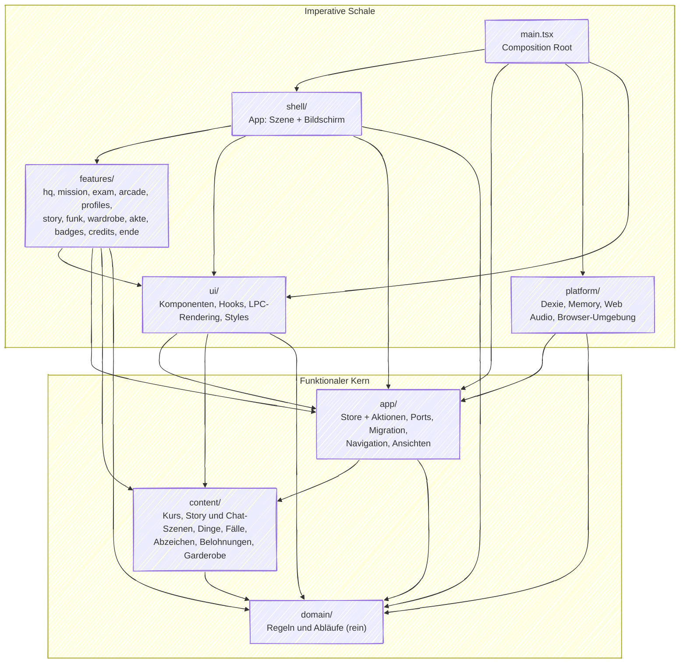
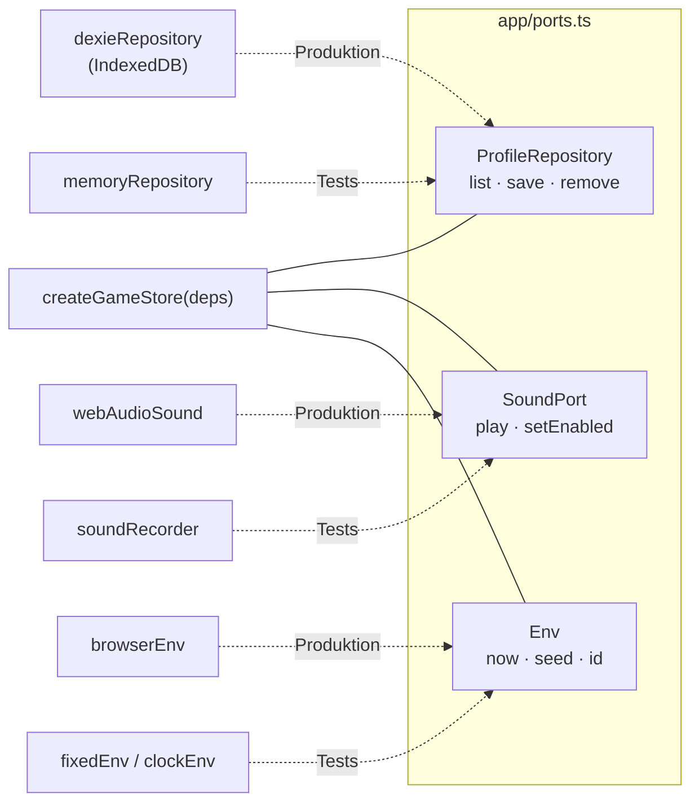
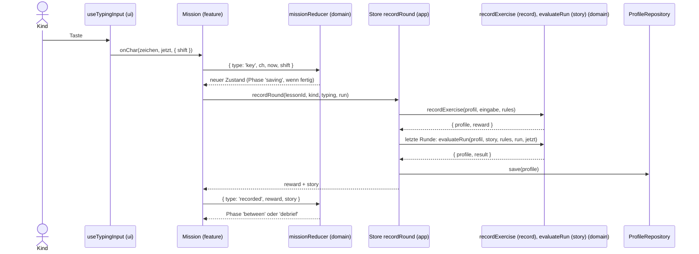
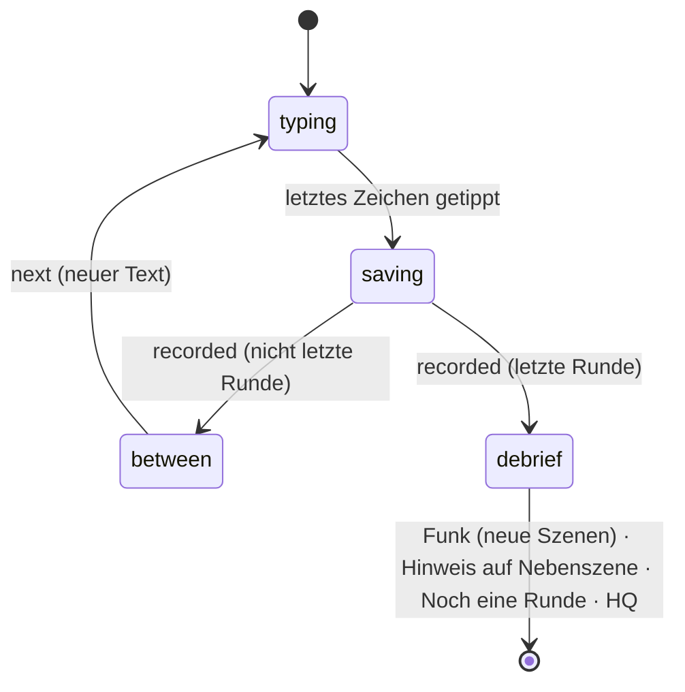
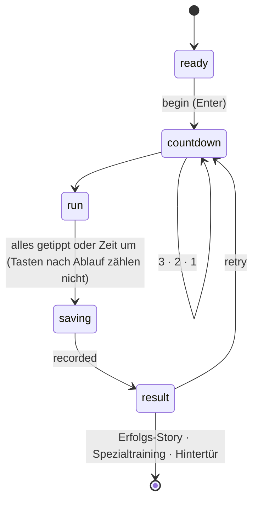
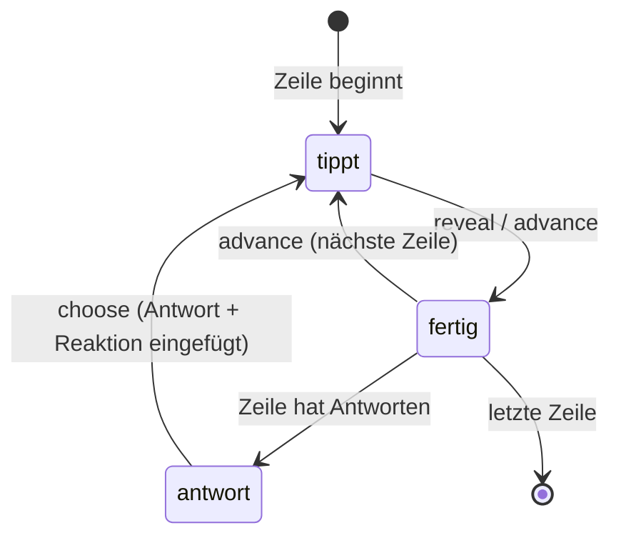
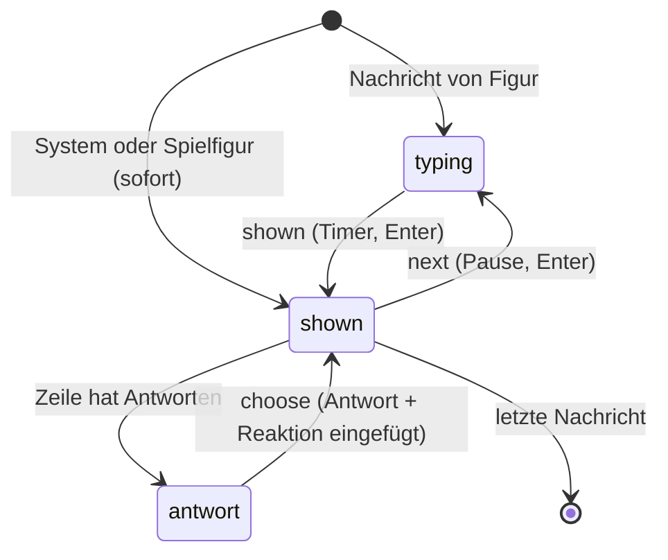
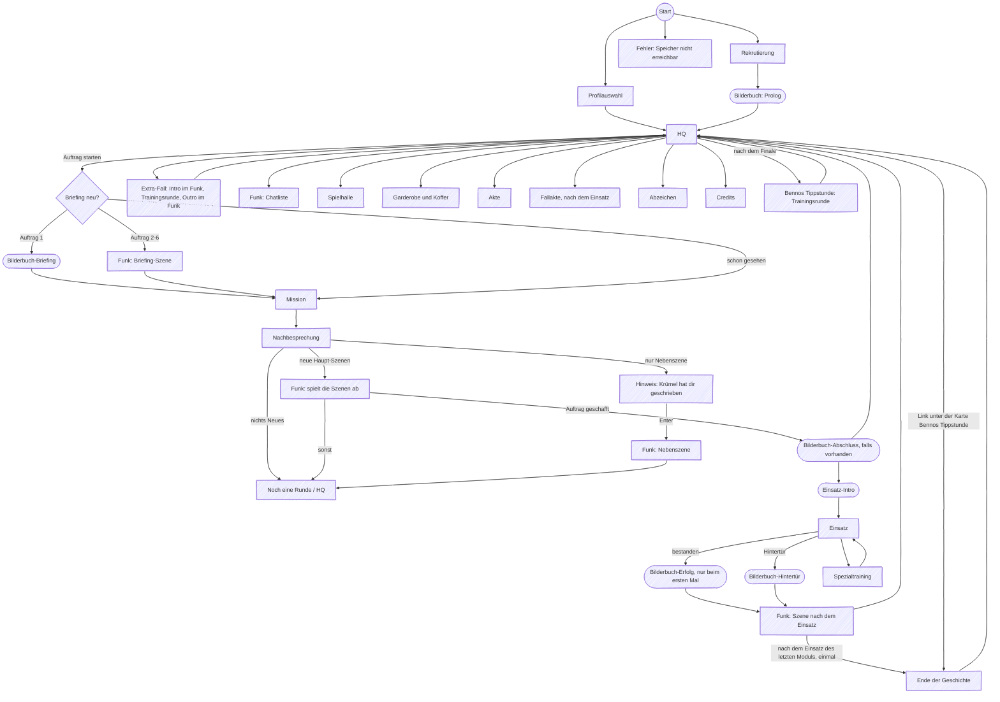
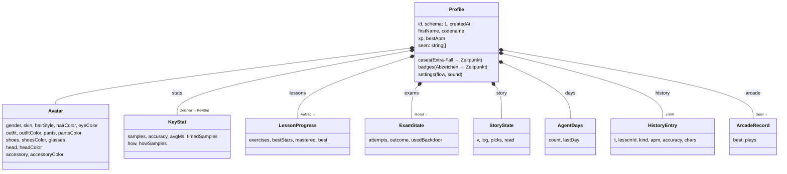

# Architektur

Stand 26.10.2026 (nach dem Aufräumen). Die tragenden Entscheidungen stehen als Protokolle in [docs/adr/](../adr/README.md).

ZEHN ist eine statische Web-App (React 19, TypeScript, Vite) ohne Server. Die Architektur folgt **„Functional Core, Imperative Shell“** (Gary Bernhardt) mit **Ports & Adapters** (Alistair Cockburn): Alle Spielregeln und Abläufe sind reine Funktionen, alles mit Seiteneffekten (DOM, Uhr, Zufall, Speicher, Ton) sitzt in einer dünnen Schale und wird über Schnittstellen angebunden. Die Schale ist nach Features geschnitten.

Ergebnis: Regeln und Abläufe lassen sich ohne Browser testen (rund 400 Tests in wenigen Sekunden), neue Inhalte brauchen keine Codeänderung, und die Abhängigkeiten zeigen immer nach innen.

## Schichten

| Schicht | Inhalt | Darf importieren |
| --- | --- | --- |
| `domain/` | Ein Thema je Datei: Tastatur (`keyboard`), Tippen (`typing`), Tastenprofil (`keyStats`), Fehlerarten je Taste (`movement`), Tastensiegel und Wärmekarte (`mastery`), Textgenerator, Kursmodell (`course`), Profil und Startwerte (`profile`), Agententage (`days`), Regeltyp `GameRules` (`rules`), Fortschritt – Abfragen, Verlauf, Siegel und Training (`progress`), Auswertung von Übung, Einsatz, Spielhalle und Hintertür (`record`), Belohnungen und Ränge (`rewards`), Abzeichen-Regeln (`badges`), Einsatz (`exam`, Ablauf `examRun`), Szenen-Typen und Finder (`scenes`), Typ des Inhaltsbündels (`storyContent`), Story – Auslöser, Log, Nebenszenen, Auswertung des Durchgangs (`story`), Story-Objekte (`storyObject`), Merker (`seen`), Chat (`chat`), Dinge und Besitz (`items`), Garderobe-Typen (`wardrobe`), Extra-Fälle (`cases`), Abläufe (Auftrag `mission`, Dialog `dialog`, Spielhalle `arcade/`), Formatierung (`format`), Zufall (`rng`) | nur `domain/` |
| `content/` | Daten: Kurs (Lehrplan, Rundenplan `practice`, Wortliste), Story-Texte **je Akt als Bündel** (`ActContent`, Typen in `story/types.ts`; die Formen von Bilderbuch, Einsatz-Story, Beschriftung und Fallakte liegen im Kern, `domain/book.ts`) im Ordner `story/aktN/` – Bilderbuch, Einsatz-Story und Beschriftung in `book.ts` (Überschriften, Segment-Name und Rahmen des Einsatzes stehen in der `ExamStory`; ihr Feld `voice` wählt die Gegenstimme über dem Tipptext: der Baron (Standard, Akt 1 bis 4) oder `speaker`, ein Lautsprecher-Pixelbild `LoudspeakerPic` (Akt 5 bis 7); der Bildschirm `features/exam/` hat keine festen Texte), Chat-Szenen in `chat.ts`, `side.ts`, `rewards.ts`, Extra-Fälle samt Szenen in `cases.ts`, Story-Objekte in `objects.ts`, Fallakte in `fallakte.ts`, Modul und Prüfprofil in `index.ts`; die Liste der Akte `ACTS` (im Spiel: Akt 1 bis 7, die Geschichte ist vollständig; nach dem Einsatz des letzten Akts meldet `storyEnd` das Spielende; die Texte `STORY_END_TEXTS` und `TRAINING_CARD` in `texts/ende.ts`) und `STAGED_ACTS` (vorbereitet; heute leer; ein Akt im Aufbau steht hier; die Dinge eines vorbereiteten Akts in `items.ts` blendet `storyOf` aus, solange ihre Szene nicht im Spiel ist) in `story/acts.ts`, daraus abgeleitet `SCENES`, `STORY_OBJECTS`, `EXTRA_CASES`, `COURSE.modules` und das Story-Bündel (`storyOf(acts)`: Szenen, Objekte, Dinge, Fälle, Bilderbuch, Beschriftungen, Fallakten); das Training als eigenes Bündel `TrainingContent` im Ordner `story/training/` (Szenen nach Runden, Abzeichen-Szene, die fünf Fälle der Woche und ihre Szenen; kein Akt, immer im Spiel; `acts.ts` reiht es hinter die Akte und vor `REWARD_SCENES` ein, `EXTRA_CASES` und `storyOf` hängen seine Fälle an; Präfix `tr-`); akt-neutrale Belohnungs-Szenen in `story/rewardScenes.ts` (Helfer `rewardBuilders.ts`); Zeilen-Helfer in `builders.ts`), Dinge (`items.ts`), Abzeichen, Belohnungen (Sterne, EP, Ränge), Oberflächentexte, die aus Zuständen entstehen, Sprechernamen, Krümels Tipps und die Überschriften der Abzeichen-Seite (`texts/`, eine Datei je Thema), Garderobe-Katalog (`WARDROBE`), Spielhallen-Katalog (Texte; die Medaillen-Schwellen `ARCADE_MEDALS` gehen als `GameRules.arcade` in den Store), Codenamen, Credits, LPC-Manifest | `domain/` |
| `app/` | `createGameStore(deps)` mit Aktionen, Ports, Navigation, Migration, Backup, Ansichten je Bildschirm in `views/` (`hq`, `funk`, `wardrobe`, `akte`, `fallakte`; Geteiltes wie `storyVars`, `rankTitle`, `sourceHintsFor` in `views/common.ts`), Regel-Verdrahtung in `rules.ts` (`GameRules`: Kurs, Abzeichen, Belohnungen, Medaillen-Schwellen der Spielhalle; dazu die Bündel `STORY` und `WARDROBE`; die einzige Stelle in `app/`, die echte Inhalte aus `content/` holt, außer `texts/`) | `content/`, `domain/` |
| `platform/` | Adapter: `dexieRepository`, `memoryRepository`, `webAudioSound`, `browserEnv`, `newId` | `app/` (Ports), `domain/` |
| `ui/` | Geteilte Komponenten (Tastatur, Tippansicht, Siegel, Story-Objekte, Dialog, Chat, Szenen, Figuren) in `components/`, Pixelgrafik ohne Spielzustand in `pixel/` (`pixelMap`, `palette`, `pictureKinds`, `pictureCheck`, `Pixel`, `pixelImage`, `sceneProps`, `propSizes`, `stage`; **ein eigenes Pixelbild ist im Browser ein einziges `<image>`**: `Grid` macht aus der Zeichen-Karte einmal eine kleine SVG-Bilddatei im Speicher (`data:`-Adresse, gemerkt je Karte, `pixelImageUrl`), statt ein `<rect>` je Fläche ins DOM zu setzen; nur bewegte Teile wie Lämpchen und Rotoren bleiben Rechtecke darüber; so bleiben lange Chats klein), Story-Bilder in `pictures/` (`StoryPicture` mit der Tabelle `pictures` und `akt1`, `akt2`, `akt3`, `akt4`, `akt5`, `akt6`, `akt7`, `cases`; alle eigenen Bilder für Test und Bogen in `registry`), Gadget-Symbole in `components/gadgetIcons`, Hooks, LPC-Rendering, Styles, Store-Context | `app/`, `content/`, `domain/` |
| `features/<name>/` | Container je Bildschirmbereich, feature-eigene Tests | `ui/`, `app/`, `content/`, `domain/` – **kein anderes Feature** |
| `shell/` | `App.tsx`: wählt Bildschirm und Hintergrund | alles außer `platform/` |
| `main.tsx` | verdrahtet echte Adapter mit dem Store | `shell/`, `app/`, `platform/`, `ui/` |

Zusätzlich gilt – alles prüft `src/architecture.test.ts` automatisch:

- Uhr, Zufall, IDs und Dexie (`Date.now`, `new Date()`, `Math.random`, `performance.now`, `crypto.*`, `dexie`) kommen nur in `platform/` vor. Bewusste Ausnahme in Ortszeit: der Kalendertag der Agententage (`dayKey`, Kinder erleben ihren Tag) und `formatDate`; die Tests laufen deshalb mit fester Zeitzone.
- `domain/`, `content/` und `app/` kennen keinen Browser (`window`, `document`, `navigator`, `globalThis`, `location`, `fetch`, Timer, Storage, IndexedDB, `AudioContext`).
- Jede Schicht benutzt nur freigegebene Pakete (`PACKAGES`: `domain/` und `content/` gar keine, `app/` nur `zustand/vanilla`, `platform/` nur `dexie`, `ui/` `react` und `zustand`, `features/` und `shell/` `react`, `main.tsx` dazu `react-dom/client` und `@fontsource/*`).
- Jede Datei liegt in einer bekannten Schicht; `features/` und `shell/` rufen nie `getState()`. `useActions()` liefert nur Aktionen (Typ `GameActions`), Daten gibt es nur über `useGame(selector)`.
- `repo.save` steht nur in `app/store.ts`.
- **Inhaltsregel:** `ui/`, `features/` und `shell/` holen aus `content/` nur Oberflächentexte (`texts/`, eine Datei je Thema; Präfix in `CONTENT_FOR_SCREENS`), `arcadeGames.ts`, `codenames.ts`, `credits.ts` und das LPC-Manifest (`CONTENT_FOR_SCREENS`); `story/acts.ts` gehört nicht dazu. Regeldaten – Kurs, Abzeichen, Belohnungen, Medaillen-Schwellen, Szenen, Dinge, Fälle, Objekte, Bilderbuch, Beschriftungen, Fallakten, Garderobe – lesen sie aus dem Store (`s.rules`, `s.story`, `s.wardrobe`), damit Tests eigene Sätze übergeben können. Reine Typ-Importe sind frei. `app/` selbst importiert Inhalte nur in `rules.ts` (und `content/texts/`); der Architektur-Test prüft es. Krümels Satzbausteine stehen als dokumentierte Ausnahme mit ihren Regeln in `domain/format.ts`.
- Keine Emoji in den Quellen, außer in Chat-Zeilen unter `content/story/` (Positivliste je Figur, [ADR-0006](../adr/0006-emoji-nur-im-agentenfunk.md)); Inhaltstests prüfen dort Liste, Grenzen und Figurenregel.

## Ports & Adapters

`list()` liefert ungeprüfte Datensätze (`unknown[]`) in beliebiger Reihenfolge; prüfen, ergänzen und nach Anlegedatum sortieren tut nur `loadProfiles` (`app/profileMigration.ts`). Ein Contract-Test prüft, dass Memory- und Dexie-Adapter sich gleich verhalten.

Zeit und Zufall sind bewusst **keine** eigenen Dienste im Kern: Der Store holt `now` und `seed` aus `env` und gibt sie als **Werte** in die reinen Funktionen. Reducer lesen nie die Uhr.

## Zustand: global und lokal

- **Global (Store, `app/store.ts`)**: Profile, aktuelles Profil, Navigation (`screen`, `screenId`), Hinweise `saveFailed` (letztes Speichern fehlgeschlagen) und `brokenProfiles` (unlesbare Akten), die Sitzungswerte `announced` und `welcome` (nicht gespeichert), dazu die Regeln und Inhalte, mit denen er rechnet (`rules`, `story`, `wardrobe`; Tests übergeben eigene Sätze an `createGameStore`). `init` lädt nur einmal (StrictMode ruft Effekte doppelt auf). Komponenten lesen per `useGame(selector)` und rufen Aktionen über `useActions()` (`ui/app/game.ts`).
- **Lokal (im Feature, `useReducer`)**: Ablaufzustand, also Runden und Phase eines Auftrags, Countdown und Zeit eines Einsatzes, Spielzustand der Spielhalle, Dialog- und Chat-Warteschlange. Die Reducer liegen im Kern.
- **Speichern** passiert nur in Store-Aktionen: Profil nehmen → reine Kernfunktion → Zustand setzen → `repo.save` → Belohnung zurückgeben. Schlägt `repo.save` fehl, läuft das Spiel weiter und die Schale zeigt einen Hinweis. Nur Löschen wartet auf den Speicher: Schlägt es fehl, setzt es ebenfalls `saveFailed`. Aktionen, die den Bildschirm wechseln, navigieren **vor** dem Speichern – ein zweites Enter trifft so nicht mehr den alten Bildschirm.

### Ablauf einer Übungsrunde

## Abläufe (Zustandsmaschinen im Kern)

### Auftrag (`domain/mission.ts`)

Runden: Aufwärmen (ab Auftrag 2), zwei Übungen – oder ein Spezialtraining. Anzahl und Länge stehen im Kurs (`course.practice`). Ein Auftrag ist geschafft, wenn jede neue Taste die Modul-Schwellen erfüllt (Übung, Genauigkeit, Flüssigkeit) und mindestens `practice.exercisesPerLesson` Übungsrunden gemacht sind. Ist er gerade geschafft, führen Enter und Esc zur Story weiter (siehe Bildschirmfluss). Wie es nach der Nachbesprechung weitergeht, entscheidet `debriefNext` (Story, neue Szenen lesen, Nebenszene lesen, noch eine Runde); der Bildschirm ordnet nur Tasten und Knöpfe zu. `runInfo` hält beim Start fest, was die Auswertung braucht; Siegel zeigt nur ein Auftrag oder Fall (`showsSeals`).

### Einsatz (`domain/examRun.ts`)

Die Einsatz-Kriterien (`ExamCriteria`, im Modul) bestimmen auch den Text und den Fehlermodus: `keys: 'learned'` nimmt alle bis dahin gelernten Tasten (die des Moduls als Fokus), `mode: 'flow'` startet den Einsatz im Fluss-Modus (Fehler leuchten, man tippt weiter; Vorgabe `strict`). Die Bewertung bleibt Genauigkeit und Tempo.

Was der Store dazu entscheidet, sind ebenfalls reine Funktionen: `examNext` (nach dem letzten Auftrag direkt zum Einsatz, wenn er noch nie gespielt wurde), `examTraining` (Spezialtraining: die schwächsten Tasten des Moduls im letzten Auftrag) und für Extra-Fälle `caseTrainingKeys` und `solveCase` (`domain/cases.ts`, prüft die Fall-ID, nur beim ersten Mal).

**Bennos Tippstunde** (nach dem Finale) ist eine Trainingsrunde (`Training.kind = 'tippstunde'`, `Round.kind = 'tippstunde'`): `tippstundeTraining` (`domain/progress.ts`) wählt den letzten Auftrag und die drei schwächsten Lerneinheiten über alle Tasten, der Store startet sie mit `beginTraining()`. Der Verlauf trägt die Art `tippstunde` (`isTrainingKind` in `domain/profile.ts`: wie `training` bei EP, Rekorden, Tastenwerten; nie als Übung eines Auftrags); eine neue Art in `history` braucht keine Migration. `roundTyping` übergibt dem Generator nur in der Tippstunde Sätze aus der Geschichte (`storySentences`, `domain/storyText.ts`: Chat-Zeilen aller Akte ohne Systemzeilen, Platzhalter, Emoji und ungelernte Zeichen, 20 bis 100 Zeichen); der Generator belegt damit `SENTENCE_SHARE` (0,3) der Länge mit ganzen Sätzen als Einheiten. Die Nachbesprechung zeigt Tempo und Genauigkeit der Runde neben dem Stand aus Akt 1 (`trainingDebrief`, `app/views/training.ts`, Komponente `ProgressSince`); verglichen wird nur mit sich selbst. Der Auslöser `training { round }` (`isDue`, `domain/story.ts`) zählt Einträge der Art `tippstunde` im Verlauf.

### Dialog (`domain/dialog.ts`)

Darstellung (`ui/components/Dialog.tsx`, `ui/styles/dialog.css`): Auf der Bühne stehen Ada, der Baron, Benno (der Baron ohne Hut und Monokel, ab dem Duell von Akt 7), Juna, Krümel und die Spielfigur (`Actor`; wer sonst spricht, bekommt keine Figur; eine Zeile mit `offstage` – über Funk gesprochen – stellt niemanden auf die Bühne, `castAt` in `domain/dialog.ts`); die Hintergründe zeichnet `ui/components/Scene.tsx` (`SceneName` in `domain/dialog.ts`, zuletzt `tresor` und `zentrale`, Ottis Laden mit der Treppe zu den Maschinen). Die Gesprächsbox hat eine **feste Höhe** (`--dialog-h`, höchstens 60 % der Fensterhöhe), bemessen für den größten Inhalt (Name, Zeile mit 120 Zeichen, drei Antworten mit Hinweiszeile): 21 rem bei breiten Fenstern, 23 rem bis 800 px Breite (dort bricht die längste Zeile dreimal statt zweimal um), 32 rem bei schmalen Fenstern (bis 700 px). „Weiter“ und die Antworten sitzen unten in der Box; ist das Fenster zu klein, scrollt die Box innen, statt zu wachsen. Die Wurzel des Bilderbuchs (`.vn`) ist mindestens `100dvh` hoch (dynamische Höhe: `100vh` zählt auf Tablets und Handys die Browserleiste mit, dann fehlte unten die Box). Der Pixelmaßstab `--px` wird je Bühne am `.vn` gesetzt: `pixelScale` bekommt dafür die gemessene Höhe der Box und begrenzt den Wert nach Höhe und Breite (Regel und Beispiele in `docs/design/grafik.md`), damit Figuren, Box und die Kulisse bis zur Fußlinie ohne Scrollen ins Fenster passen; was die Kulisse nicht deckt, füllt die Hintergrundfarbe der Szene. Übungsbildschirm, Einsatz und Spielhalle richten Tasten, Übungstext und Siegel-Leiste unter 760 px Fensterhöhe nach der Höhe (`keyboard.css`, `typing.css`, `seals.css`, `exam.css`), der Übungstext unter 1100 px Breite auch nach der Breite; `e2e/layout.spec.ts` misst das auf den Zielgrößen. Weil die Box nie ihre Höhe ändert, misst `useStageMetrics` (Maßstab und Anhebung) nur beim Erscheinen und bei Fenstergrößen-Änderung neu: Der Hintergrund hängt mit seiner Bodenlinie fest an der Oberkante der Box und springt weder bei anderem Text noch bei Antworten. Wer die Grenzen für Zeilenlänge oder Antworten ändert (`story.test.ts`), prüft die Höhe mit.

### Chat (`domain/chat.ts`)

Szenen werden im Agentenfunk abgespielt. `playStart` macht aus mehreren Szenen eine Warteschlange (Antworten mit `needs` sind nach Besitz gefiltert, Platzhalter gefüllt), `playReducer` steuert sie:

Die Dauer von „tippt …“ (`typingMs`, 0,5 bis 1,5 s) ist eine reine Funktion der Länge; eine korrigierte Nachricht (`Line.strike`, nur der Sprecher `tippi`: der durchgestrichene Teil steht in derselben Blase vor dem Text, `Chat.tsx`) tippt den durchgestrichenen Teil mit (`lineTypingMs`). Den Takt gibt der Funk-Bildschirm. **Lange Chats laden nach:** `Chat.tsx` zeigt vom Verlauf nur die letzten `HISTORY_PAGE` (60) Nachrichten, darüber holt der Knopf „Frühere Nachrichten“ je 60 weitere (er nimmt den Fokus nicht, Enter spielt weiter ab; die Lage im Chat bleibt beim Nachladen stehen); „erste Blase einer Folge“ wird über den ganzen Verlauf berechnet, die erste gezeigte Blase zeigt immer Gesicht und Namen. `Bubble` ist gemerkt (`memo`, gleiche Zeile heißt: gleiche Felder), der Verlauf und die Platzhalter in `FunkScreen` bleiben stabil, sodass eine neue Nachricht oder die Tipp-Anzeige alte Blasen nicht neu zeichnet. Nach dem Finale hat „ZEHN intern“ über 770 Nachrichten; geöffnet sind es etwa 700 Elemente statt 78 000. Sprecher sind eine feste Liste (`Speaker` in `domain/dialog.ts`, seit Akt 6 mit `tippi` und `benno`); jeder braucht Name und Kürzel (`texts/speakers.ts`), eine Emoji-Liste (`story/emoji.ts`), Farben (`funk.css`) und ein Bild oder sein Kürzel (`SpeakerPic`). `chatHistory` berechnet den Verlauf eines Chats aus Log und gewählten Antworten – gespeichert wird er nie.

Die Spielhallen-Spiele (`domain/arcade/regen.ts`, `tresor.ts`) sind ebenfalls reine Schritt-Funktionen (`regenStart`/`regenTick`/`regenType`, ebenso `tresor…`). Ihr Zufallszustand ist eine Zahl, Töne werden als `events` im Zustand gemeldet und von der UI abgespielt.

## Navigation und Bildschirmfluss

Das Navigationsziel `funk` trägt `play` (Szenen-IDs), optional `chat`, `then` (wohin es am Ende geht, Esc auch), `label` und `again` („Noch eine Runde“ als Hauptknopf, `then` als HQ-Knopf); die Knöpfe am Ende berechnet `chatEnd`. Wege mit „beim ersten Mal“ sind reine Funktionen in `app/navigation.ts` (`briefingRoute`, `examRoute`, `afterExamScreen`): Sie liefern `{ screen, save? }`, der Store navigiert und speichert danach. Bilderbuch-Szenen speichern nur einen Verweis (`StoryRef`, `domain/book.ts`); die Texte löst `storyLines` über das Bündel `s.story` erst beim Anzeigen auf. Ob ein Briefing oder Intro schon gezeigt wurde, merken typisierte Schlüssel (`domain/seen.ts`) – nur Schlüssel, die auch gelesen werden. Chat-Szenen stehen im Story-Log. Die Fallakte (`{ name: 'fallakte', moduleId }`, `features/fallakte/`) ersetzt das frühere Bilderbuch „Wie geht es weiter?“: Ihre Daten stehen im Bündel des Akts (`fallakte.ts`, Abruf `fallakte(story, moduleId)` aus `domain/book.ts`), welche Firewall-Zeile gilt, liefert `fallakteView` (`app/views/fallakte.ts`) aus dem Ergebnis des Einsatzes; dieselbe Ansicht filtert die Zeilen unter „gelöst“ und „offen“, die an eine Antwort gebunden sind (`ifPicked`: eine Zeile erscheint nur, wenn das Kind eine bestimmte Antwort gewählt hat), und liefert die Verdächtigen (`Fallakte.suspects`: Name, Stand, Text, Bild, Treffer-Zeilen mit `ifPicked`), deren Treffer mit `matchesPicks` über `story.picks` gefiltert werden (kein neues Profilfeld); der Merker `seenKey.fallakte(moduleId)` (gesetzt von `markFallakteSeen`) steuert das „Neu“ im HQ (`hqView.modules[].fallakteNew`). Das Ende der Geschichte (`{ name: 'ende' }`, `features/ende/EndScreen.tsx`, Texte `STORY_END_TEXTS`) hängt am letzten Modul des Kurses: `storyEnd` (`domain/progress.ts`) liefert es, sobald dessen Einsatz gespielt ist; `afterExamScreen` (bekommt dazu den Kurs) schickt nach der Szene nach dem Einsatz dorthin, solange `seenKey.storyEnd(moduleId)` fehlt (gesetzt von `markStoryEndSeen`, wenn der Bildschirm öffnet); `hqView.storyEnd` zeigt unter dem letzten Modul die Karte „Bennos Tippstunde“ (`TRAINING_CARD`) mit dem Link „Das Ende noch einmal lesen“, der den Bildschirm wieder öffnet.

## Story, Chat und Belohnungen

Quellen der Regeln: [Story und Agenten-Chat – Mechanik](../design/story.md), [Story-Regeln](../design/story-regeln.md), [Belohnungen und Ausrüstung](../design/belohnungen.md). Die Drehbücher der Akte, aus denen die Texte stammen, liegen nicht im Repository; die Texte selbst stehen in `content/story/`.

| Baustein | Wo | Aufgabe |
| --- | --- | --- |
| Szene (`StoryScene`) | `content/story/aktN/*.ts` (je Akt), `content/story/training/` (Training), `content/story/rewardScenes.ts` (akt-neutral), gesammelt in `story/acts.ts` | ID (Speicherformat, **nie umbenennen**), Chat, Auslöser, Zeilen, `gives` |
| Auslöser | `domain/scenes.ts` (Typen, `sceneFor`) | `briefing`, `stage` (25/50/75 % des besten Fortschritts), `mastered`, `exam`, `badge`, `rank` (Rang-Schlüssel), `training` (n-te Tippstunden-Runde), `caseOpen`, `case` (Intro/Outro), `side` (Nebenszene) |
| `dueScenes` | `domain/story.ts` | alle erfüllten Zustands-Auslöser, die noch nicht im Log stehen |
| `withStory` | `app/store.ts`, in `persist()` | löst bei **jedem** Speichern fällige Szenen aus – keine Aktion kann es vergessen |
| Auswertung des Durchgangs | `evaluateRun` (`domain/story.ts`), aufgerufen vom letzten `recordRound` mit `{ last, logStart, wasCurrent }` (`runInfo`) | idempotent; liefert `{ open, side }` an die Nachbesprechung |
| `nextSideScene` | `domain/story.ts` | je Strang (Strangname je Akt) die nächste `order`; dran ist der Strang mit der ältesten letzten Szene; nur im Akt des Auftrags, bei Wiederholung im abgeschlossenen Akt (`wholeModule`) mit allen Aufträgen als erreicht |
| Story-Log im Profil | `profile.story` `{ v, log, picks, read }` | ausgelöst (Log), gewählte Antworten, gelesen |
| `STORY`-Bündel | `app/rules.ts` → Store-Feld `story` | `{ version, scenes, objects, items, cases, book, labels, fallakten, fallaktenDamage }` (Bilderbuch, Beschriftung und Fallakte je Modul, abgeleitet mit `storyOf(ACTS)`; `fallaktenDamage`: die Zeiträume `{ from, until }` aus den Bündeln, in denen die Fallakten im HQ zerkratzt sind – ein abgeleiteter Anzeigezustand aus dem Story-Log, kein Profilfeld: `fallaktenScratched` in `domain/book.ts`, `scratched` in `fallakteView`, `fallakteScratched` je Modul in `hqView`); Tests übergeben eigene Sätze |
| Besitz | `ownedItems` (`domain/items.ts`) | wird **berechnet**: `gives` ausgelöster Szenen, Abzeichen, gelöste Fälle |
| Siegel | `sealOf`, `liveSeals` | drei Riegel je neue Taste; Live-Werte = Stand beim Rundenstart + Anschläge bis zum letzten Wortende. Riegel mit Schließschwelle: `Profile.latches` merkt die schon einmal offenen Riegel, fortgeschrieben Anschlag für Anschlag (`applyLatched`, beim Speichern und live in `liveSeals`; ein Riegel, der mitten in der Runde aufgeht, bleibt also offen), beim Laden mit `updateLatches` abgeglichen; sie schließen erst unter `CLOSE_ACCURACY_MARGIN` / über `CLOSE_TEMPO_FACTOR`. Anzeige und Freischaltung (`allMastered`) nutzen dieselbe Regel; `weakness`, `masteryScore` und der Textgenerator rechnen mit den echten Werten. `hitsToOpen` = fehlende Treffer bis „Genau“ |
| Story-Objekt | `domain/storyObject.ts` (`stageAt`, `objectPercent`), `content/story/aktN/objects.ts`, Darstellung `ui/components/StoryObject.tsx` | feste Stufenbilder je Auftrag; Arten: Text, Zeilen, Knoten, Bild, Ausweis (`idcard`, Teile je Stufe); Aussehen `look: 'goldcard'` für die Post des Diebs, Wasserzeichen, gezeichnete Tinte (`marks`) und Tintenkleckse (`INK_BLOT`) je Stufe; Fortschritt = `lessons[id].best` (nur steigend, höchstens 99 % vor „geschafft“) |

**Inhaltsversion (`STORY_VERSION`).** Kommen neue Szenen dazu, die bei bestehenden Spielständen nicht nachträglich erscheinen sollen, wird die Version erhöht. `migrateProfile` gleicht Profile mit älterer Version ab: Was jetzt fällig wäre, gilt als ausgelöst **und** gelesen (Zeitpunkt 0). So gibt es keine Flut von Nachrichten und keine Paket-Flut. Szenen, die schon im Log stehen, behalten ihren Lesestand (eine ungelesene Paket-Meldung bleibt „neu“). Folge für alte Spielstände: Meldungen zu schon vorhandenen Abzeichen und Fall-Ankündigungen sehen sie nicht – die Dinge liegen trotzdem im Koffer, die Fälle stehen im HQ. Unbekannte IDs im Log bleiben liegen und werden ignoriert. Stand: 1 Platzhalter, 2 alle Szenen von Akt 1, 3 Meldungen zu Belohnungen und Rängen, 4 Extra-Fälle; 13 Akt 7 im Spiel (die Versionen dazwischen: je ein Akt).

**Niemand bleibt stecken.** Haupt-Szenen verlangen nur Gadgets, die eine frühere Haupt-Szene selbst verschenkt hat; Gadgets aus Spielhalle und Extra-Fällen bringen nur **zusätzliche** Antworten (`needs`) oder Extra-Fälle. Besitz entsteht beim **Auslösen**, nicht beim Lesen – wer jeden Chat sofort mit Esc schließt, hat trotzdem alles. Das beweisen `story.test.ts` und `rewards.test.ts` (statisch) und das Store-Szenario „Mindestweg“ in `app/store.test.ts`.

**Extra-Fälle** spielen auf dem begonnenen aktuellen Auftrag (Briefing gesehen), sonst auf dem letzten geschafften (`begunLessonId`, `domain/progress.ts`); sichtbar sind sie erst ab dem begonnenen `fromLesson` (`caseVisible`; `afterScene` und `afterCase` legen die Reihenfolge fest), spielbar mit dem Gadget (`needs` ist optional: Fälle ohne Bedingung und ohne Belohnung `gives` sind möglich); ohne Gadget zeigt das HQ eine gesperrte Karte mit dem Weg dorthin. So übt ein Fall nie Tasten, die das Kind noch nicht kennt, und löst kein Briefing nebenbei aus.

**Übrige Nebenszenen.** Wird der Extra-Fall „Kringels Briefkasten“ erst nach Akt 1 gelöst, kommt die Kringel-Nebenszene mit `afterCase` („Kringel hat mir ein Gedicht gebracht …“) nicht mehr am aktuellen Auftrag, aber beim Wiederholen eines geschafften Auftrags aus Akt 1 (`RunStart.replay`, `nextSideScene` mit `wholeModule`); das HQ zeigt dann unter der Missionskarte des Akts eine kleine Zeile ohne Zahl (`moreSides`).

## Datenmodell

Gespeichert wird jedes Profil als ein Dokument in IndexedDB (`zehn`, Tabelle `profiles`). Ältere Stände bringt **eine** Funktion auf den aktuellen Stand: `migrateProfile` in `app/profileMigration.ts`. Sie wird beim Laden und beim Import einer Sicherungsdatei benutzt. Pflicht sind nur `id`, `codename` und `schema`; jedes andere Feld wird auf seinen Typ geprüft (Tastenwerte, Aufträge, Einsätze, Abzeichen, Verlauf, Einstellungen, Spielhalle, Merker, Story-Stand, Fälle): Kaputte Einträge fallen weg, fehlende oder falsch getypte Felder bekommen die Startwerte aus `createProfile`. Die Signatur ist `migrateProfile(raw, rules, story, wardrobe)`: Der Store reicht seine eigenen Regeln, Story-Inhalte und seinen Garderobe-Katalog (gültige Avatar-Werte) durch, damit Tests mit kleinen Sätzen nicht mit dem echten Kurs migrieren. Alte Spielstände bekommen `lessons[id].best` (geschafft = 1, sonst der aktuelle Stand der Tasten) und den Story-Stand (siehe Inhaltsversion). Beim Laden überspringt `loadProfiles` unlesbare Akten einzeln (die Profilauswahl nennt ihre Anzahl), statt alle zu sperren.

## Inhalte erweitern

| Vorhaben | Wo | Tests |
| --- | --- | --- |
| Neuer Akt / Auftrag | Ordner `content/story/aktN/` (Vorbild `akt1/`) als Bündel `ActContent`: Modul mit Aufträgen (Titel, Schwellen, Wortliste) in `index.ts`, Briefing, drei Stufen und Abschluss als Chat-Szenen in `chat.ts`, Story-Objekt in `objects.ts`, Einsatz-Story (`won`, `lost`, `segments`) und Beschriftung in `book.ts` (Einsatz-Kriterien im Modul: optional `keys: 'learned'` für alle gelernten Tasten und `mode: 'flow'` für den Fluss-Modus, siehe `akt3/index.ts`; Akt 4 `akt4/index.ts` mit Großbuchstaben als Zeichen der Aufträge), Fallakte; erst in `STAGED_ACTS`, dann nach `ACTS` (`story/acts.ts`); Szenen-IDs mit Präfix `aN-` ab Akt 2 | `course.test.ts` und `story.test.ts` (`src/content/`) prüfen IDs, Wörter (je neuer Buchstaben-Taste mindestens 3; Komma, Punkt und Bindestrich hängt der Generator an Wörter, `PUNCTUATION` in `domain/textGenerator.ts`; jede Taste kommt in Übungstexten auf mindestens 80 % ihres Gewichts), Story-Vollständigkeit je Auftrag und Modul über alle Akte; das Prüfprofil `check` des Bündels (getippte Antworten, ab wann der Name des Barons fallen darf, Spoiler der Fallakte) macht die Regeln akt-fest; danach `npm run ids` (trägt neue gespeicherte IDs in `knownIds.ts` ein, `knownIds.test.ts` erzwingt das) |
| Neues Abzeichen | `content/badges.ts` (`BadgeRule`) | Fall knapp unter/über der Schwelle in `domain/badges.test.ts` |
| Neues Garderobe-Teil | LPC-Teil in `scripts/lpc/parts.ts` → `npm run assets:lpc`, Eintrag in `content/wardrobe.ts` (mit `source: { badge }`), Zettel in `content/items.ts`, Paket-Szene in `story/rewardScenes.ts` (oder `rewards.ts` des Akts) | `rewards.test.ts` prüft Manifest, Quelle und Meldung |
| Neue Chat-Szene / Nebenszene | `chat.ts` bzw. `side.ts` im Ordner des Akts (Helfer aus `builders.ts`), Inhaltsversion erhöhen | `story.test.ts` prüft IDs, Kurzformen, Sprecher je Chat, Auslöser; neue Antwort-IDs trägt `npm run ids` in `knownIds.ts` ein |
| Neues Gadget / Neuer Extra-Fall | `content/items.ts`, Fall mit Szenen in `cases.ts` im Ordner des Akts | `rewards.test.ts` (Quelle, Nutzung) und `story.test.ts` (Fälle, Erreichbarkeit) |
| Neues Spielhallen-Spiel | Mechanik in `domain/arcade/`, Name im Typ `ArcadeGame` (`domain/profile.ts`), Eintrag in `content/arcadeGames.ts` (Texte) und `ARCADE_MEDALS` (Schwellen, TypeScript erzwingt jedes Spiel), Bildschirm in `features/arcade/` (mit `useArcadeRun` und `ArcadeFrame`), Zuordnung in `ARCADE` (`shell/App.tsx`, TypeScript erzwingt sie), Liste in `rewards.test.ts` | Kern-Test mit vorgespulter Zeit, ein Komponententest |

Details: [Grafik-Pipeline](assets.md) · [Tests](tests.md) · [Wegweiser](wegweiser.md)

## Entscheidungen

| Entscheidung | Begründung |
| --- | --- |
| Statische Web-App, Daten nur lokal (IndexedDB) | Kein Server, keine Konten, Datenschutz für Kinder; Sicherung als Datei |
| React statt Game-Engine | Fast alles ist Oberfläche (Text, Tastatur, Menüs); Animationen mit CSS/SVG/Canvas reichen. PixiJS bleibt eine Option für spätere Actionszenen. |
| Functional Core / Imperative Shell + Ports & Adapters | Regeln und Abläufe ohne Browser testbar, Inhalte austauschbar, klare Abhängigkeiten |
| Abläufe als Reducer im Kern, lokal per `useReducer` | Deterministisch (Zeit und Zufall als Werte), gut testbar; globaler Store bleibt klein |
| Zustand (vanilla Store + Context) | Wenig Boilerplate; ein Store pro Test mit Attrappen |
| Feature-Ordner für die Schale | Bildschirmbereiche bleiben übersichtlich, Features koppeln nicht aneinander |
| Tests fast nur ohne Browser (Vitest node + happy-dom), ein Playwright-Smoke-Test | Schnelle Rückmeldung (Sekunden statt Minuten), Browser nur für das Zusammenspiel |
| LPC-Grafiken, im Browser umgefärbt | Avatar in Ebenen mit allen Farbkombinationen ohne zusätzliche Dateien; Lizenzen siehe [Grafik](../design/grafik.md) |
| Schriften lokal (`@fontsource`, nur die `latin-*`-Dateien) | Offline-fähig, keine Anfragen an Dritte; wenige Dateien in `dist/` |

## Stolpersteine

- **Feststelltaste:** Ist sie an, zählt `useTypingInput` Buchstaben nicht (sonst wäre jeder Anschlag ein Fehler) und meldet `capsLock`; Tippansicht und Spielhalle zeigen `CapsLockHint`.
- **Umschalt-Hand:** `useTypingInput` merkt sich über keydown/keyup von `ShiftLeft`/`ShiftRight`, welche Hand die Umschalttaste hält, und gibt sie als drittes Argument `{ shift: 'left' | 'right' | undefined }` an `onChar` (unbekannt oder beide heißt `undefined`; Verlassen des Fensters setzt zurück). Nur die Übungsrunde wertet sie aus: `typeChar` schreibt sie zusammen mit dem getippten und dem vorigen erwarteten Zeichen in `ScoredKeystroke` (flüchtig, nie im Profil), `roundReview` leitet daraus Fehlerart und falsche Umschalt-Hand ab. Siegel, Sterne und Profil bleiben unberührt.
- **Tastaturlayout:** Ausgewertet wird `KeyboardEvent.key`. Ein englisches Layout erkennt `layoutMismatch` (y/z vertauscht, `;` statt `ö`) und zeigt einen Hinweis. AltGr kommt unter Windows als Strg+Alt und wird von `useTypingInput` durchgelassen.
- **Tippphase: die Tastatur ist fest, der Text gibt nach.** In Übung, Einsatz und Tippstunde ist die Tippphase (Klasse `typing-phase` am Bildschirm, `ui/styles/typing.css`) so hoch wie das Fenster (`100dvh`; der `100vh`-Rückfall davor greift nur ohne Build, der Build lässt ihn weg, weil alle seine Zielbrowser `dvh` kennen; ohne `dvh` wäre die Tippphase eine fließende Seite wie früher). Kopf, Siegel, Hinweiszeile und Tastatur nehmen sich ihren Platz; das Textfeld (`TypingPanel`: `.text` mit Rahmen, darin der Rollbereich `.text-scroll`) bekommt den Rest, zeigt so viele ganze Zeilen wie möglich (mindestens zwei) und rollt zeilenweise mit der Schreibmarke. Die Regel ist die reine Funktion `nextScrollTop` (`ui/components/textScroll.ts`); der Hook `useTextScroll` (`ui/hooks`) ruft sie nach jedem Anschlag in `useLayoutEffect` und über einen `ResizeObserver` bei Größenänderung oder Drehung auf. Unten angeschnittene Zeilen blendet eine Maske aus (`data-cut`), bei `prefers-reduced-motion` rollt es sofort. Kurze Texte sehen aus wie sonst. Je nach Fensterform gibt es drei Anordnungen:

  | Form | Bedingung (Media Query) | Anordnung |
  | --- | --- | --- |
  | Groß | ab 760 px Höhe und 1100 px Breite | untereinander, Werte wie am Monitor |
  | Niedrig oder schmal, sonst | unter 760 px Höhe oder unter 1100 px Breite | untereinander, kompakt (kleinere Schrift, Tasten und Abstände nach Fensterhöhe) |
  | Quer und niedrig | `(max-height: 759px) and (min-aspect-ratio: 5/4) and (min-width: 700px)` | Seitenleiste links (Kopf, Story-Objekt, Siegel, Krümels Hinweis; im Einsatz Baron, Ziel, Zeitbalken, Firewall), Text und Tastatur rechts; die Tasten sind dort höher (`7dvh`) |

  Die Seitenleiste (Klasse `with-side`, `.screen-side` als Wrapper, untereinander `display: contents`) gibt es in Übung und Extra-Fällen (dort stehen Siegel) und im Einsatz in den Phasen bereit, Countdown und Tippen; Tippstunde, Spezialtraining, Zwischenergebnis und Nachbesprechung haben keine. Die Spielhalle und alle anderen Tastaturen behalten ihre Regeln. Gemessen wird das im Layout-Test ([Tests](tests.md)).
- **Sichere Umgebung:** `crypto.randomUUID` gibt es nur über HTTPS/localhost; deshalb erzeugt `platform/id.ts` IDs mit Ersatzweg.
- **Datenverlust:** Browserdaten löschen = Spielstand weg → „Akte sichern“.
- **Spielstände je Adresse:** `localhost` und eine IP-Adresse haben getrennte Datenbanken.
- **Grafiklizenzen:** Credits-Seite im Spiel; abgeleitete CC-BY-SA-Grafiken stehen ebenfalls unter CC-BY-SA.
