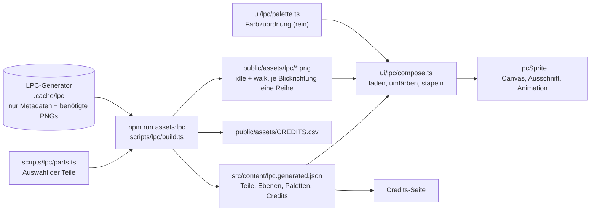
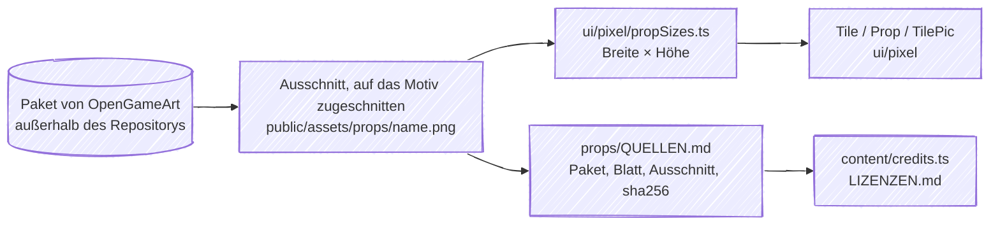

# Grafik-Pipeline (LPC)

Stand 08.11.2026

Die Figuren stammen aus dem [Universal LPC Spritesheet Character Generator](https://github.com/LiberatedPixelCup/Universal-LPC-Spritesheet-Character-Generator). Ein Build-Skript holt nur die benötigten Teile, schneidet die vier Blickrichtungen aus und erzeugt Manifest und Credits. Im Browser werden die Ebenen umgefärbt und gestapelt. Auswahl, Lizenzen und Bewertung der Sammlungen: [Grafik](../design/grafik.md).

## Ablauf

1. **Auswahl** (`scripts/lpc/parts.ts`): je Teil die Sheet-Definition des Generators, ggf. eine feste Farbvariante und die Körpertypen (`teen`, `female`, `male`).
2. **Build** (`npm run assets:lpc`): Das Skript klont den Generator beim ersten Mal sparsam nach `.cache/lpc` (nur Metadaten), lädt einzelne PNGs bei Bedarf per `git show` nach, übernimmt die vier Reihen der Blickrichtungen (oben/Rücken, links, unten/vorne, rechts; Reihenfolge im Manifest unter `directions`) und schreibt PNGs, Manifest und Credits. Jede PNG trägt einen Inhalts-Hash im Namen (`…__walk.712155ad.png`): Ändert sich eine Grafik, ändert sich ihre Adresse, und kein Browser zeigt eine alte Kopie aus dem Cache. Nach `npm run assets:lpc` den Dev-Server neu starten – er kennt nur die Dateien von seinem Start. Aus dem fremden Repository wird **kein Code ausgeführt**, nur JSON und PNG gelesen.
3. **Anzeige** (`ui/lpc/`): `compose.ts` lädt die Ebenen, färbt sie per Palette um (`palette.ts`: Basisvariante → Zielvariante, Toleranz ±1) und stapelt sie nach z-Reihenfolge. `LpcSprite` zeichnet einen Ausschnitt (`crops.ts`) in einer Blickrichtung (`facing`, Standard vorne; Drehen mit `turn`) und animiert `idle` bzw. `walk`. Die gestapelten Streifen werden zwischengespeichert (höchstens 150) – Drehen lädt und färbt nichts neu. Eigenheit der Grafiken: Brillen, Stirnband, Krawatte und Fliege sind von hinten unsichtbar. Der Schal (`scarf`, Platz „Zubehör“) ist gebaut, steht aber erst im Katalog, wenn ein Teil dafür eingetragen ist. Figuren als Ebenenlisten: `characters.ts` (Avatar aus der Garderobe, Ada, Baron).

## Ein neues Teil hinzufügen

1. Passende Sheet-Definition im Generator suchen (`.cache/lpc/sheet_definitions/…`), prüfen, ob es den Körpertyp und die Animationen `idle`/`walk` gibt.
2. Eintrag in `scripts/lpc/parts.ts`, dann `npm run assets:lpc`. Hat die Definition keine Palette, aber eine Variante `white` mit den Tönen der Palette-Basis (Gürtel, Hosenträger), steht im Eintrag `variant: 'white'` und `materials: ['cloth']`: Das Teil ist dann wie die Krawatte umfärbbar. Hat die Definition selbst die Palette „cloth“ (Epauletten, Manschetten, Hohe Socken, der Umhang), reicht `def` und `bodyTypes`; ein Teil, das es schon für `male` gibt (der Umhang des Barons), bekommt `teen` in `bodyTypes` dazu. Teile mit festen Varianten (Melone, Dreispitz, Augenklappe) nennen eine `variant`.
3. Für die Garderobe: weiter mit dem Rezept „Neues Garderobe-Teil oder Farbpaket“ in [AGENTS.md](../../AGENTS.md) (Quelle, Übergabe-Szene, Zettel).
4. `npm test`: `rewards.test.ts` prüft, dass jedes Garderobe-Teil im Manifest existiert (Quellen der Teile: Szenen in `content/story/rewardScenes.ts` bzw. dem `rewards.ts` des Akts).

Die erzeugten Dateien (`lpc.generated.json`, `public/assets/lpc/`, `CREDITS.csv`) nie von Hand ändern.

## Kacheln für Kulissen und Story-Bilder

Gegenstände (Brote, Mehlsack, Ofen, Werkzeugwand, Laptop, Laterne, Gleis, Konsolen, das Paket) kommen nicht aus dem Generator, sondern von Hand aus LPC-Paketen auf OpenGameArt. Es gibt dafür kein Skript; jede Kachel ist eine eingecheckte Datei mit Herkunftsnachweis.

1. **Paket laden** (außerhalb des Repositorys; Archive und Entpacktes sind nur Daten) und eine Lizenz ohne GPL wählen: CC0, OGA-BY, CC-BY oder CC-BY-SA.
2. **Ausschnitt** des Motivs aus dem Blatt, auf den sichtbaren Teil zugeschnitten, sonst unverändert (keine neuen Farben, nicht skaliert, ohne halbdurchsichtigen Schatten), nach `public/assets/props/<name>.png`.
3. **Nachweis** in `public/assets/props/QUELLEN.md`: Paket, Autorinnen und Autoren, URL, Datei und Blatt, Ausschnitt, Lizenz, sha256 des Archivs und der Kachel. Pakete von bluecarrot16 verlangen die vollständige CREDITS-Datei neben den Kacheln (`props/CREDITS-*.txt`, unverändert aus dem Archiv).
4. **Größe** in `PROP_SIZES` (`ui/pixel/propSizes.ts`); `propSizes.test.ts` prüft jede Datei gegen den PNG-Kopf und dass keine Datei fehlt oder übrig ist.
5. **Credit** in `OTHER_CREDITS` (`content/credits.ts`, mit `changes` bei CC-BY-SA) und in `public/assets/LIZENZEN.md`.
6. **Anzeige:** In Kulissen `Prop` (Mitte, Unterkante) oder `Tile` (linke obere Ecke) auf dem 320×180-Raster; als Story-Bild die Bildart „Kachel“ (`{ tile, title, over }`, gezeichnet von `TilePic` in `ui/pixel/Tile.tsx`): Ein Kachelpixel ist ein Rasterfeld, Gezeichnetes darüber (`over`) liegt im selben Raster. Die Klasse `prop` hält die Pixel scharf (`image-rendering: pixelated`).

## Lizenzen

Die Teile stehen unter CC0, CC-BY, OGA-BY, CC-BY-SA und/oder GPL (je Datei in `CREDITS.csv`). Die Credits-Seite im Spiel listet alle Urheber. Abgeleitete Figuren aus CC-BY-SA-/GPL-Teilen stehen unter denselben Lizenzen (`public/assets/LIZENZEN.md`).
