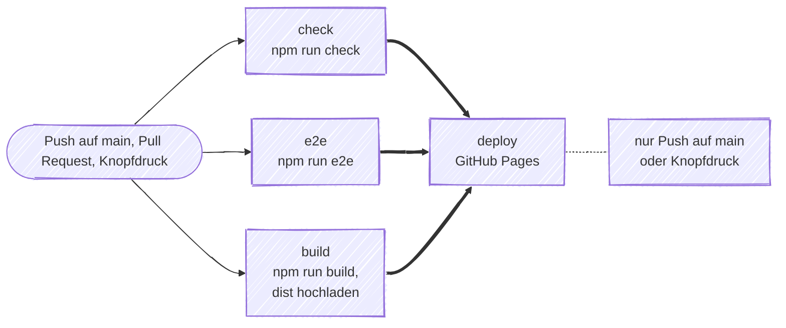

# Pipeline: Prüfen, bauen, veröffentlichen

Stand 08.11.2026

Eine Pipeline auf GitHub Actions (`.github/workflows/ci.yml`, Name „CI“) prüft jeden Stand und legt das gebaute Spiel auf GitHub Pages ab: `https://laberning.github.io/ZEHN/`. Die Entscheidung steht in [ADR-0007](../adr/0007-veroeffentlichung-github-pages.md). Sie läuft, sobald das Repository auf GitHub liegt.

## Jobs

| Job | Was | Wann |
| --- | --- | --- |
| `check` | `npm run check`: Typen, ESLint ohne Warnungen, Tests mit Coverage-Schwellen | immer |
| `e2e` | Chromium installieren, `npm run e2e` (Smoke- und Layout-Test; ein vergessenes `test.only` lässt ihn scheitern, `forbidOnly` in `playwright.config.ts`); bei einem Fehler wird `playwright-report/` und `test-results/` als Artefakt `playwright-report` hochgeladen | immer |
| `build` | `npm run build`, dann `dist/` als Pages-Artefakt hochladen | immer (bei Pull Requests prüft er nur den Build) |
| `deploy` | veröffentlicht das Artefakt von `build` | nur bei Push auf `main` oder Knopfdruck auf `main` (auf einem anderen Zweig prüft der Knopfdruck nur), und nur wenn `check`, `e2e` und `build` grün sind; nie bei Pull Requests |

Jeder Prüf-Job holt den Code (`actions/checkout`), richtet Node aus `.nvmrc` ein (`actions/setup-node` mit npm-Cache) und führt `npm ci` aus. Die Rechte: oben im Workflow nur `contents: read`; `pages: write` und `id-token: write` hat nur `deploy`. Deploys laufen nacheinander (`concurrency: pages`, ohne einen laufenden abzubrechen). Ein roter Stand auf `main` lässt die zuletzt veröffentlichte Version stehen.

Alle Testdateien in `e2e/` laufen mit; Reste von Versuchen gehören nicht ins Repository.

## Einmal in GitHub einstellen

Nachdem das Repository angelegt und `main` hochgeladen ist: **Settings → Pages → Build and deployment → Source: GitHub Actions**. Mehr ist nicht nötig; der Vite-Build nutzt relative Pfade (`base: './'`) und läuft im Unterpfad `/ZEHN/`. Alle Seiten unter `laberning.github.io` teilen sich einen Ursprung; die IndexedDB heißt deshalb `zehn` und muss eindeutig bleiben.

## Issue-Vorlagen

Wer unter **Issues → New issue** einen Eintrag anlegt, wählt eine Vorlage aus `.github/ISSUE_TEMPLATE/`. Die Vorlagen sind Formulare, auf Deutsch und in Du-Form für Kinder:

| Datei | Vorlage | Titel | Inhalt |
| --- | --- | --- | --- |
| `fehler.yml` | „Etwas funktioniert nicht“ | `Fehler: …`, Label `bug` | wo im Spiel, was gemacht, was passiert, was erwartet, Browser und Gerät |
| `rueckmeldung.yml` | „Rückmeldung zum Spiel“ | `Rückmeldung: …` | Anlass (bis zum Ende gekommen, unklar oder langweilig, gefallen), wie weit (ein Eintrag je Akt, neuer Akt: hier ergänzen), freier Text |
| `config.yml` | Auswahlseite | | leere Issues bleiben erlaubt; Links zu Häufigen Fragen und Spielanleitung |

Beide Formulare bitten wie [Rückmeldung geben](../spiel/rueckmeldung.md) um keine Spielstände und keine persönlichen Daten. Wer die Seite für Spieler ändert, zieht die Vorlagen nach; `src/pipeline.test.ts` prüft, dass beide zusammenpassen.

## Versionen anheben

- **Node:** die Hauptversion steht nur in `.nvmrc`; `engines.node` in `package.json` ist `>=` dieselbe Zahl, der Workflow liest `.nvmrc`. `src/pipeline.test.ts` prüft, dass beide zusammenpassen. Nach dem Wechsel `npm install` mit der neuen Version, damit `package-lock.json` zu ihrem npm passt, und `AGENTS.md` anpassen.
- **Runner:** der Name steht fest im Workflow (`ubuntu-26.04`), nicht `ubuntu-latest`. Ein neuer Runner ist eine bewusste Änderung an allen Jobs; der Test `src/pipeline.test.ts` nennt den Namen ebenfalls.
- **Actions:** auf ihrer Hauptversion (z. B. `@v7`); neue Hauptversionen von Hand eintragen.
- **Playwright:** `npx playwright install --with-deps chromium` braucht eine Playwright-Version, die den Runner kennt.

## Prüfen ohne GitHub

Solange es kein Remote gibt, sichert `src/pipeline.test.ts` (Node-Stufe) die Regeln des Workflows. Zusätzlich kann man [actionlint](https://github.com/rhysd/actionlint) als Binary außerhalb des Repositorys laufen lassen (kein npm-Skript, keine Abhängigkeit). Seine Liste bekannter Runner kennt `ubuntu-26.04` noch nicht; man gibt das Etikett über eine Konfiguration außerhalb des Repositorys an (`self-hosted-runner: labels: [ubuntu-26.04]`, `actionlint -config-file …`). Ohne das ist diese eine Meldung die einzige.

## Warum TypeScript 6 und nicht 7

TypeScript steht auf `^6.0.3`, obwohl 7 erschienen ist: `typescript-eslint` unterstützt TypeScript 7 noch nicht (Stand der Neueste: nur `<6.1.0`). Sobald es das tut, ist der Wechsel eine eigene kleine Änderung.
