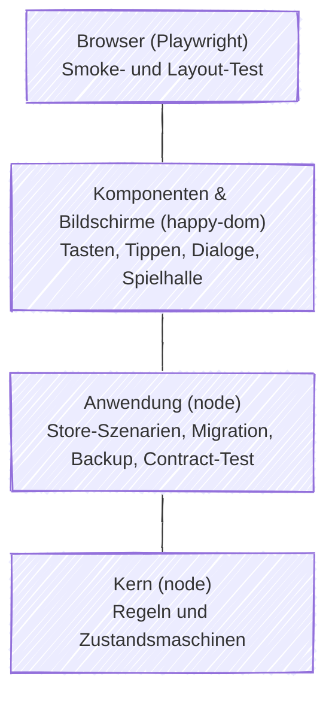

# Tests

Stand 26.10.2026

**Grundsatz: fast alles ohne Browser.** Regeln und Abläufe sind reine Funktionen (siehe [Architektur](architektur.md)) und werden direkt getestet; Bildschirme laufen in happy-dom mit Testing Library und Fake-Timern. Der echte Browser prüft nur noch das Zusammenspiel in einem Smoke-Test; ein zweiter Browser-Test misst das Layout, weil nur ein echter Browser Maße kennt (happy-dom rechnet kein Layout).

| Befehl | Was | Dauer |
| --- | --- | --- |
| `npm test` | alle Unit- und Komponententests | ca. 3 s |
| `npm run test:watch` | dasselbe im Beobachtungsmodus | – |
| `npm run check` | Typprüfung + ESLint (0 Warnungen) + Tests mit Coverage-Schwellen – **vor jedem Commit** | ca. 10 s |
| `npm run test:coverage` | nur Tests mit Abdeckung und Schwellen | ca. 5 s |
| `npm run e2e` | Playwright-Browser-Tests in Chromium (Smoke, Layout und Funk) – vor Meilensteinen | ca. 2,5 min |
| `npm run e2e:fixture` | Profil-Sicherungen für die Browser-Tests neu erzeugen (`e2e/fixtures/`), wenn `src/test/e2eFixtures.test.ts` es verlangt | ca. 1 s |
| `npm run e2e:firefox` | dieselben Browser-Tests in Firefox | ca. 2,5 min |
| `PW_PORT=5180 npm run e2e` | dieselben Tests auf einem anderen Port, wenn 5174 belegt ist (unter WSL vergibt Windows den Port gelegentlich als Quellport einer Chrome-Verbindung; Fehlerbild „Port 5174 is already in use“) | ca. 2,5 min |

## Test-Pyramide



| Ebene | Dateien | Umgebung | Inhalt |
| --- | --- | --- | --- |
| Kern | `src/domain/**/*.test.ts` | node | Tippen, Tastenprofil, Mastery, Tastensiegel (`seals.test.ts`), Lerneinheiten (`learning.test.ts`: Zuordnung Großbuchstabe → Umschalttaste), Siegel der Umschalttaste (`seals.test.ts`), Textgenerator (`textGenerator.test.ts`: Form der Satzzeichen und der Großschreibung, Menge, unveränderter Text ohne Satzzeichen und ohne Großbuchstaben mit festen Startwerten; Testkurse `PUNCT_COURSE` (Satzzeichen-Modul `p2`, dazu `p3` mit Buchstaben, Großbuchstaben, `? !`, `: ;`, `" '` und Wörtern mit Apostroph; Form je Zeichen, Großschreibung nach `? !`, Menge) und `SHIFT_COURSE` (Kleinbuchstaben, dann Großbuchstaben je Hand, ß, Ä Ö Ü) und `NUMBER_COURSE` (die Module von `PUNCT_COURSE`, dazu `n1` mit der Zahlenreihe in vier Aufträgen `4 5 6 7`, `3 8`, `1 0`, `2 9`; Form der Zahlengruppen, Satzzeichen an Zahlen, Großschreibung nach „10.“, Menge und Anteil; die Wort-Regel in `course.test.ts` nimmt Ziffern aus, die 80-%-Regel gilt für sie), `SPECIAL_COURSE` (die Module von `NUMBER_COURSE`, dazu `x1` mit den Alt-Gr-Zeichen in drei Aufträgen `@ €`, `{ [ ] }`, `\ ~ |` und einem längeren Einsatz; Form je Rolle, nur erlaubte Zeichen, Menge, unveränderter Text ohne Sonderzeichen; die Wort-Regel nimmt Ziffern und Sonderzeichen aus, die 80-%-Regel gilt für sie), alle in `src/test/factories.ts`), Fortschritt (`progress.test.ts`) und Auswertung (`record.test.ts`), Belohnungen, Agententage, Szenen-Auslöser, Log, Nebenszenen und Auswertung eines Durchgangs (`story.test.ts`), Chat-Verlauf und Abspielen (`chat.test.ts`), Besitz (`items.test.ts`), Extra-Fälle (`cases.test.ts`), jedes Abzeichen knapp unter/über der Schwelle (`badges.test.ts`), Auftrag-, Einsatz- und Dialog-Reducer, Buchstabenregen und Tresorknacker mit vorgespulter Zeit, Formatierung, Rundenhinweis (`roundReview.test.ts`: Anschläge → Hinweis → Satz, Finger-Helfer, Tipps nach Thema, Rundenüberschrift) |
| Inhalte | `src/content/course.test.ts`, `story.test.ts`, `rewards.test.ts`, `akt1.test.ts`, `akt2.test.ts`, `akt3.test.ts`, `akt4.test.ts`, `akt5.test.ts`, `akt6.test.ts`, `akt7.test.ts`, `story/emoji.test.ts`, `texts/<thema>.test.ts`, `knownIds.test.ts`, `ids.test.ts` | node | Gespeicherte IDs (Szenen, Antworten, Dinge, Fälle, Abzeichen, Garderobe) gibt es noch **und jede vorhandene steht in `knownIds.ts`** (Fehlt eine: `npm run ids`; `ids.test.ts` prüft die Funktion dahinter); Aufteilung: `course.test.ts` Lehrplan und Wörter (die Regel „je neuer Taste 3 Wörter“ gilt für Buchstaben-Tasten und je Umschalttaste – Wörter, die mit einem Buchstaben ihrer Hand beginnen; große Umlaute Ä Ö Ü: Wörter, die mit ä, ö oder ü beginnen –, ein Wort-Zeichen (Apostroph) zählt wie ein Buchstabe: drei Wörter, die es enthalten; der 80-%-Test für alle Lerneinheiten, auch Satzzeichen und Umschalttasten an den Testkursen), `story.test.ts` Story, Chat-Szenen, Längen, Echos, Spoiler, Fallakten, Objekte und Extra-Fälle, `rewards.test.ts` Dinge, Belohnungen, Abzeichen, Garderobe und Spielhalle, `akt1.test.ts` bis `akt7.test.ts` nur Besonderheiten ihres Akts (`akt7.test.ts`: Gerüst, 18 Haupt-Szenen, Dinge und Abschlussakte des vorbereiteten Akts 7; sein Einsatz-Kriterium prüft `domain/flows.test.ts`: Über 300 Startwerte erreicht jedes der neun Sonderzeichen mindestens 80 % seines Gewichtsanteils, weil neun Zeichen in vier Rollen nicht in 95 % aller 60-Sekunden-Texte vorkommen können); zustandsabhängige Texte; Lehrplan konsistent, Wörter tippbar, Briefing/Stufen/Abschluss je Auftrag, Mini-Tastatur der Briefings zeigt genau die neuen Tasten (`keystrokeFor`; Großbuchstaben nur ihre Umschalttaste, Satzzeichen mit Umschalttaste Taste und Umschalttaste, Zeichen der Alt-Gr-Ebene Alt Gr und ihre Taste), das Briefing (Chat und Bilderbuch zusammen) nennt je neuer Lerneinheit ein Fingerwort passend zu `keystrokeFor` (bei Umschalt-Einheiten „hält“) und der Abschluss je neuer Lerneinheit ebenfalls (bei Umschalt-Einheiten „hält“/„gehalten“; Story-Regel 13), Längen: Chat-Nachricht 100 Zeichen, eine Zeile mit Mini-Tastatur (`keys`) 120, Einsatz-Story, Fallakte und Objekt je Modul bzw. Auftrag (alle Regeln laufen über `ACTS` und `STAGED_ACTS`, also auch für einen vorbereiteten Akt; was je Akt verschieden ist, liest der Test aus dem Prüfprofil `check` des Bündels: getippte Antworten `typed`, ab wann der Name des Barons fallen darf `revealFrom`, Wörter, die die Fallakte nicht verraten darf `spoilers`), **Szenen**: IDs und Antwort-IDs eindeutig, Kurzformen höchstens drei Wörter, Emoji nur in Figuren-Zeilen aus der Positivliste des Sprechers (`story/emoji.ts`, ≤ 1 je Nachricht, ≤ 2 je Szene; `story/emoji.test.ts` prüft die Liste selbst, auch „bis Emoji 5.0“; Längen zählen Code-Punkte), erlaubte Sprecher (in Krümel- und Juna-Chat schreibt kein Erwachsener, auch nicht Tippi oder Benno), korrigierte Nachrichten (`strike` nur bei Tippi, nie leer, ohne Emoji; die Längenregel zählt durchgestrichenen Teil und Text zusammen), Auslöser verweisen auf Vorhandenes, Platzhalter, getippte Antworten nur mit gelernten Zeichen, **an jeder Auswahl eine Antwort ohne Gadget**; **Dinge**: genau eine Quelle, Nutzung, je Abzeichen höchstens eine Belohnung, jede Belohnung hat ihre Meldung; Extra-Fälle erreichbar; jedes Garderobe-Teil im LPC-Manifest |
| Gesamtdurchlauf | `src/app/playthrough.test.ts` | node | Ein Kind spielt das ganze Spiel über den Store (echter Kurs und Abzeichen): Spielhalle, je Akt langsame Durchgänge am offenen Auftrag, Abschluss, Einsatz (Hintertür, dann bestanden), Wiederholungen im abgeschlossenen Akt, bis keine Nebenszene und kein Geschenk mehr wartet, Extra-Fälle mit ihren Gadgets, Finale, 50 Runden Bennos Tippstunde bis `tr-round-50` und die fünf Fälle der Woche. Je Modul ein Test (unter einer Sekunde), die Tests bauen aufeinander auf. „Abdeckung“: jede Szene fällig oder in `SCENE_EXCEPTIONS` mit Grund, jedes Abzeichen vergeben (oder in `BADGE_EXCEPTIONS`), jeder Fall gelöst, jedes Ding im Besitz, jede Fallakte zeigt mit der verwiesenen Antwort ihre gebundenen Zeilen und Treffer. Ausnahmen müssen wirklich ungezeigt sein, sonst schlägt der Test an |
| Antwort-Verweise | `src/content/pickRefs.test.ts` | node | Jeder `ifPicked`-Verweis (Zeilen, Bilderbuch, Fallakten, Treffer) zeigt auf eine vorhandene, wählbare Antwort (Gadget auf dem Weg existiert); Antwort-IDs je Szene eindeutig; unbenutzte Antworten sind erlaubt |
| Anwendung | `src/app/store.test.ts`, `navigation.test.ts`, `src/app/views/*.test.ts` | node | Ansichten je Bildschirm (`hq`, `fallakte`, `wardrobe`, `akte`, `common`); Wege mit „beim ersten Mal“ und Ende des Funks (`navigation.test.ts`); ganze Abläufe über den Store: Profil anlegen → Prolog, Briefing-Gating, Auftrag schaffen, Einsatz mit Intro/Fehlversuchen/Hintertür/Bestehen, Spielhalle, Szenen-Auswertung je Durchgang, Extra-Fälle, Garderobe und Koffer, Sicherung, Migration (auch Felder mit falschem Typ), **Mindestweg** und Alte-Spielstände-Szenarien (Beweis, dass niemand stecken bleibt); Fehlerfälle: kaputte Akte, Datenbank weg, Speichern scheitert, doppeltes Absenden, `init` doppelt aufgerufen |
| Plattform | `src/platform/*.test.ts` | node + `fake-indexeddb` | **Contract-Test**: Memory- und Dexie-Repository verhalten sich gleich (auch für alte Datensätze ohne Anlegedatum); ID-Erzeugung ohne sichere Umgebung |
| LPC | `src/ui/lpc/palette.test.ts` | node | Umfärben (rein), alle Figuren-Ebenen vorhanden |
| Textfeld rollt mit | `src/ui/components/textScroll.test.ts` (node), `src/ui/hooks/useTextScroll.test.tsx` (happy-dom) | node + happy-dom | Roll-Regel als reine Funktion (bleibt, rückt zeilenweise nach, zurück bei größerem Fenster und neuem Text, nur eine Zeile, letzte Zeile, Ausblendung unten); der Hook setzt die Rollhöhe und reagiert auf Größenänderung, mit vorgegebenen Maßen (happy-dom kennt kein Layout); die echten Maße prüft der Layout-Test. Die Klassen der Tippphase (`typing-phase`, `with-side`) prüfen `Mission.test.tsx` und `Exam.test.tsx` |
| Eigene Bilder | `src/ui/pixel/pictures.test.ts` (sieht die Flächen über `inlineImages`, `pixelImage.ts`), `pixelImage.test.ts` (Bildadresse: ein `rect` je Fläche, gemerkt, Obergrenze), `palette.test.ts`, `pixelMap.test.ts`, `pictureKinds.test.ts` | node | Jedes registrierte Bild (Story-Bilder, Gadget-Symbole, Krümel, Lautsprecher und Schloss; ohne Kacheln, heute nur das Paket) hat ohne Ausnahme (ein Test je Bild) die Größe einer Bildart, nur Palettenfarben, nur Rechtecke und Kontur oder nichts am Rand; die Dateien in `ui/pictures/`, `ui/components/` und `ui/pixel/` haben keine freien Hexwerte, außer Kulissen und Story-Objekt-Zeichnungen (`NOT_PICTURES`: `Scene.tsx`, `sceneProps.tsx`, `StoryObject.tsx`; der Test meldet einen Eintrag ohne freie Farben). Die Bild-Orte zeigen jede Bildart, auch die Gadget-Größe, in einem ganzzahligen Vielfachen. Jede Palettenfarbe stammt aus der genannten LPC-Rampe, drei Töne je Familie, höchstens 24 Farben; `fromPalette` lehnt Zeichen ohne Farbe ab; die Breiten der Bild-Orte in `ui/styles/` (`.pic-<art>`) sind ganzzahlige Vielfache der Rasterbreite (die Stylesheets liest der Test als `?raw`, dafür `css.include` im Projekt `unit`) |
| Architektur | `src/architecture.test.ts` | node | Import-Regeln der Schichten (alle Import-Formen), Paket-Positivliste je Schicht, keine Feature-Kopplung, keine Import-Kreise (auch über Typ-Importe), Uhr/Zufall/DB nur in `platform/`, kein Browser im Kern, kein `getState()` in Features und Shell, `repo.save` nur im Store, Inhaltsregel (Bildschirme holen Regeldaten nur über den Store), keine Emoji in den Quellen außer unter `content/story/` |
| Pipeline | `src/pipeline.test.ts` | node | Der Workflow `.github/workflows/ci.yml` (Runner, Node aus `.nvmrc`, die drei npm-Befehle, Deploy hängt von allen Prüf-Jobs ab und läuft nicht bei Pull Requests, Rechte) und `.nvmrc` passend zu `engines` in `package.json`; siehe [Pipeline](pipeline.md) |
| Issue-Vorlagen | `src/pipeline.test.ts` | node | Die Vorlagen in `.github/ISSUE_TEMPLATE/` passen zu `docs/spiel/rueckmeldung.md` (Namen, Fragen, Anlässe, Hinweis auf persönliche Daten), die Auswahl „Wie weit bist du gekommen?“ nennt jeden Akt aus `ACTS` mit seinem Titel; die Links der Auswahlseite zeigen auf vorhandene Spieler-Dokumente; siehe [Pipeline](pipeline.md) |
| Komponenten | `src/**/*.test.tsx` | happy-dom | App-Durchlauf (Rekrutierung → Prolog → HQ → Auftrag), Speicher-Hinweis, Auftrag (inkl. Siegel, Feststelltaste, Ziffernblock-Hinweis, Rundenhinweis, englisches Layout, alle Wege nach der Nachbesprechung), Agentenfunk (Chat, Antworten, getippte Antwort; „Frühere Nachrichten“; eine neue Nachricht zeichnet den Verlauf nicht neu), Einsatz (Erfolg erstes/zweites Mal, Hintertür), HQ (Paket, Koffer, Fallakte), Fallakte, Spielhalle, Profile (Import, Überschreiben), Akte (Sichern) |
| Browser | `e2e/smoke.spec.ts` | Chromium | App startet, echtes Tippen, LPC-Canvas, Spielstand übersteht Neuladen |
| Browser (Layout) | `e2e/layout.spec.ts` (Schritte gemeinsam in `e2e/helpers.ts`) | Chromium | Auf allen Größen bleibt die Startseite ohne Akten in der Breite, ohne Überbreite. Auf den Zielgrößen (Tablets quer und hochkant, kleiner Laptop, 1280×900, 1920×1080) liegen im Bilderbuch alle Figuren, die Gesprächsbox, „Weiter“ und die Antworten ganz im Fenster. Im Übungsbildschirm liegen bei einem **Text von 400 Zeichen** Kopfzeile, Siegel-Leiste, Text, Hinweiszeile, Schreibmarke und die ganze Tastatur (Tastenschrift ab 11 px) im Fenster, die Seite scrollt nicht: am Anfang, nach der Hälfte des Texts (das Textfeld rollt mit, Marke und nächste Zeile bleiben sichtbar), mit Warnzeile (Ziffer vom Ziffernblock, `Shift+Numpad1`) und auf 1024×560 nach einer Drehung auf 768×950 und zurück. Die Anordnung wird gemessen: quer und niedrig steht die Siegel-Leiste links neben dem Text (1024×560: Tasten mindestens 36 px hoch, mindestens fünf Zeilen Text), sonst darüber. Die lange Runde entsteht mit der Entwickler-Abkürzung F9 (Dev-Server, 400 Anschläge pro Minute). Mit den gesicherten Akten (siehe unten) auf den quer-niedrigen Zielgrößen: Auftrag mit vier Siegeln („Der Schaltplan“: die Seitenleiste rollt innen nicht), Bennos Tippstunde und Einsatz von Akt 7 (bereit, Countdown, Tippen); auf 390×750 (Akt 7): HQ mit Willkommensgruß, Agentenakte, Übungsrunde (Krümels Hinweis mindestens 160 px breit), Nachbesprechung, Einsatz und Tippstunde ohne Überbreite. Auf zwei Handy-Größen sonst nur: keine Überbreite (auch HQ und Agentenakte in Akt 1), Tastatur sichtbar. 1280×900 behält die Werte des Monitors (`--px` 5 px, Übungstext 30 px, Taste 46 px). Neue Zielgröße: Eintrag in `TARGETS` |
| Browser (Funk) | `e2e/funk.spec.ts` | Chromium | Der Chat „ZEHN intern“ nach dem Finale (772 Nachrichten) hat beim Öffnen höchstens 3 000 Elemente, nach einmal „Frühere Nachrichten“ höchstens 5 000; die Stelle im Chat bleibt beim Nachladen stehen (± 2 px); Enter drückt den Knopf nicht. Obergrenzen für Elemente statt Zeiten; Öffnen- und Scrollzeiten (CPU ×1 und ×6) misst man von Hand mit einem Wegwerf-Test außerhalb des Repositorys |
| Browser-Sicherungen | `e2e/fixtures/nach-finale.json`, `vor-schaltplan.json`; `src/test/e2eFixtures.test.ts` | node | Zwei Profil-Sicherungen, damit der Browser Akt 4 bis 7 erreicht: nach dem Finale (alles geschafft) und kurz vor dem Auftrag „Der Schaltplan“ (vier neue Tasten). Erzeugt von `npm run e2e:fixture` (`scripts/e2e/fixtures.ts`, Bau in `src/test/finalFixtures.ts`: das ganze Spiel mit den Szenario-Helfern, schnell getippt, damit die Texte 400 Zeichen lang sind; alles gelesen). Der Browser lädt sie über die Datei-Sicherung der Startseite (`loadBackup`, `data-testid="backup-input"`), die Migration hält sie gültig. `loadBackup` wartet, bis die Akte in IndexedDB steht (gleiche Länge des Story-Logs wie in der Sicherung), und lädt erst dann einmal neu: ein früheres Neuladen bricht das Speichern im Hintergrund ab, unter Last kam die Akte sonst nie an. `src/test/e2eFixtures.test.ts` prüft bei jedem `npm run check`, dass sie laden und dort stehen, wo die Tests sie brauchen; nach einer Änderung an Kurs oder Inhalten sagt er, dass man sie neu erzeugt. Die Zeitstempel sind alt: das HQ zeigt Krümels „Willkommen zurück“ (erst nach dem Neuladen, beim Wählen der Akte) |

Endung entscheidet die Umgebung: `*.test.ts` läuft in node, `*.test.tsx` in happy-dom (Vitest-Projekte `unit` und `dom` in `vite.config.ts`).

## Test-Hilfen (`src/test/`)

| Hilfe | Zweck |
| --- | --- |
| `profile(overrides)` | Profil mit Standardwerten (angelegt um `T0`) |
| `T0`, `DAY` | fester Startzeitpunkt (1.10.2026, 15 Uhr Ortszeit) und ein Tag in ms |
| `strokes(ch, n, { correct, ms })` | Anschläge für das Tastenprofil (ein Großbuchstabe zählt für die Umschalttaste) |
| `keyStat(over)` | Tastenwerte einer Taste (20 Anschläge, alle richtig, 500 ms; `timedSamples` folgt `samples`) |
| `storyLog(ids, { read, picks, v })` | Story-Stand mit diesen Szenen im Log, z. B. `profile({ story: storyLog(['s1'], { read: ['s1'] }) })` |
| `mastered(...ids)` | Aufträge als geschafft markieren |
| `TEST_COURSE`, `TEST_RULES` | Mini-Kurs (2 Module, niedrige Schwellen) für Regeltests |
| `TEST_MASTERY` | Kriterien für Regeltests, die keinen Kurs brauchen |
| `kr`, `ada`, `ans`, `inChat` … (`content/story/builders.ts`) | Story-Zeilen in Tests genauso schreiben wie im Inhalt |
| `ALL_ACTS`, `ALL_SCENES`, `ALL_COURSE`, `ALL_STORY`, `mainRank` … (`content.ts`) | Akte, Szenen, Kurs und Story-Bündel (`storyOf(ALL_ACTS)`, für Bildschirme vorbereiteter Akte: `renderApp({ rules: { ...RULES, course: ALL_COURSE }, story: ALL_STORY })`) über `ACTS` und `STAGED_ACTS` samt Hilfen der Inhaltstests |
| `NO_BOOK`, `TEST_FALLAKTE` (`factories.ts`) | leeres Bilderbuch und kleinste Fallakte für kleine eigene `StoryContent`-Sätze |
| `fixedEnv()` | Uhr zum Vorspulen (`advance`), vorhersehbarer Zufall und IDs (Store-Tests) |
| `clockEnv()` | Uhr folgt den Fake-Timern (Komponententests) |
| `soundRecorder()` | merkt sich gespielte Töne |
| `masteredModule(course, moduleId)` | alle Aufträge eines Moduls geschafft (Einsatz frei) |
| `renderApp(ui?, { profiles, select, screen, delay, story })` | Store mit Memory-Repository + Fake-Timer + user-event; liefert `press`, `type`, `wait`, `finishDialog`, `finishChat`, `dialogText`. `story` übergibt eigene Story-Inhalte (kleine Szenensätze statt des echten Akts) |
| `currentText(container)` | aktuellen Übungstext lesen (`data-text`) |
| `cleanTyping(text, msPerKey, start)` (`scenario.ts`) | fertig und fehlerfrei getippter `TypingState` (Standard 400 ms je Zeichen) |
| `playRun(store, lessonId)` | ein Durchgang (Aufwärmen + Übungen) mit dem **echten Kurs** nur über Store-Aktionen |
| `playLessonToMastery(store, lessonId)` | Durchgänge, bis der Auftrag geschafft ist (höchstens 10, sonst Fehler) |
| `failExamUntilBackdoor(store, moduleId)` | Einsatz nicht bestehen, bis die Hintertür offen ist, dann nehmen |

## So testet man …

**eine Regel:** reine Funktion mit `TEST_RULES` aufrufen.

```ts
const r = recordExercise(profile(), { lessonId: 'a1', kind: 'exercise', result, scored: strokes('f', 12), now: T0 }, TEST_RULES);
expect(r.reward.newBadges).toContain('erster-auftrag');
```

**einen Ablauf:** Reducer mit Aktionen füttern; Zeit ist ein Wert.

```ts
let s = examReducer(examRunStart(module, startTyping('fj')), { type: 'begin' });
s = examReducer(s, { type: 'tick', now: 10_000 }); // Zeit vorspulen
```

**ein Spielhallen-Spiel:** Zeit als Wert vorspulen – `tresorTick` mit großen Sprüngen, `regenTick` in Bildschritten (16 ms), weil Tropfen pro Takt fallen. Kein Zeitraffer im Produktcode.

**einen Anwendungsfall:** Store mit Attrappen bauen und Aktionen aufrufen.

```ts
const store = createGameStore({ repo: memoryRepository([profile()]), sound: soundRecorder(), env: fixedEnv() });
await store.getState().init();
store.getState().selectProfile('p1');
await store.getState().beginLesson('m1-l1'); // → Briefing-Story
```

**eine Story-Regel:** Store mit eigenem `StoryContent` (Szenen, die nur die geprüfte Regel brauchen) und `playRun` des Szenario-Helfers.

```ts
const store = createGameStore({ repo, sound, env }, undefined, undefined, { version: 1, objects: [], items: [], cases: [], scenes: [...] });
const rewards = await playRun(store, 'm1-l1');
expect(rewards.at(-1)!.story.open).toEqual(['s25', 's50']);
```

**einen Bildschirm:** `renderApp` mit Startbildschirm, dann wie ein Mensch bedienen.

```ts
const app = await renderApp(undefined, { profiles: [profile()], select: 'p1', screen: { name: 'mission', lessonId: 'm1-l1' } });
await app.type(currentText(app.container));
await screen.findByText(/geschafft/);   // erst Ergebnis abwarten …
await app.press('{Enter}');             // … dann Enter (Doppel-Enter-Schutz)
```

## Konventionen und Fallstricke

- **Chat und Dialog:** „tippt …“ dauert je Nachricht 0,5–1,5 s Fake-Zeit. `app.finishChat()` spielt einen Chat bis zum Ende (Enter überspringt, Antworten wählt es mit der übergebenen Zahl, getippte Antworten tippt es selbst); `app.finishDialog()` und `dialogText()` warten zuerst, bis die Schreibmaschine fertig ist – sonst sind die Antworten noch nicht da.
- **Stufen im Test auslösen:** `lessons[id].best` steuert die Stufen. Soll ein Durchgang eine Stufe bringen, aber den Auftrag nicht schaffen, genügt ein Profil mit langsam geübten Tasten (`avgMs` über der Schwelle): Tempo-Riegel zu, Fortschritt steigt.
- Keine `waitForTimeout`/echten Wartezeiten: Zeit über Fake-Timer (`app.wait(ms)`) oder als Wert in Reducer-Aktionen.
- **Doppel-Enter-Schutz:** `useKey` ignoriert Tasten 400 ms (`KEY_GRACE_MS`) nach dem Aktivwerden, `useChoiceKeys` ebenso die Zifferntasten nach dem Erscheinen neuer Antworten (Pfeile wirken sofort, gehaltene Tasten nie). `app.press()` wartet deshalb kurz; nach dem Tippen erst auf das Ergebnis warten (`findByText`), dann drücken.
- **Schreibmaschinen-Effekt:** Dialogtexte erscheinen nach und nach – `app.dialogText()` wartet, bis alles sichtbar ist.
- **Fake-Timer und Testing Library:** Testing Library erkennt Fake-Timer nur über ein globales `jest`. `src/test/setup-dom.tsx` stellt dafür einen kleinen Shim bereit; ohne ihn hängen `findBy…` und `user.click`.
- **Hängende Läufe:** Läuft ein Komponententest in den Timeout, würde sein `findBy…`/`waitFor` weiterlaufen und ab dem nächsten Test dessen Fake-Uhr weiterschalten – endlos, mit 100 % CPU, und der Lauf wird nie fertig. `src/test/waitForGuard.ts` (eingebunden in `setup-dom.tsx`) bricht ein solches `waitFor` beim nächsten Schritt mit einer klaren Meldung ab. Damit Last allein keinen Timeout auslöst, haben die happy-dom-Tests 20 s statt 5 s. Muss man einen hängenden Lauf doch abbrechen, die ganze Prozessgruppe beenden (z. B. `timeout -k 10 900 npm run check`), sonst bleiben Vitest-Worker übrig.
- **Canvas:** happy-dom kann kein Canvas. `LpcSprite` ist im DOM-Setup gemockt; die Umfärbe-Logik ist rein und wird in node getestet.
- `window.confirm` gibt es in happy-dom nicht – per `vi.stubGlobal('confirm', vi.fn())` ersetzen.
- Texte mit `{` oder `[` maskiert `app.type()` automatisch für user-event. Sondertasten wie `{CapsLock}` deshalb über `app.user.keyboard()`.
- Gestubbte Globals (`vi.stubGlobal`) setzt Vitest nach jedem Test zurück (`unstubGlobals`).
- **Zeitzone:** Agententage (`dayKey`) und `formatDate` rechnen bewusst in Ortszeit. `vite.config.ts` setzt für Testläufe `TZ=Europe/Berlin`, bevor Vitest die Test-Prozesse startet – die Tests laufen so auf jedem Rechner gleich (geprüft in `days.test.ts` an einer Tagesgrenze). Zeitpunkte in Tests daher mit `new Date(jahr, monat, tag, …)` oder `T0` + Vielfache von `DAY` bilden.
- **Pipeline:** Die Pipeline auf GitHub fährt den vollen Check (`npm run check`, `npm run build`, `npm run e2e`); siehe [Pipeline](pipeline.md).
- Coverage-Schwellen: `domain/` 90 % Zeilen / 80 % Zweige, `app/` 85 % Zeilen – geprüft in `npm run check`. Für die UI gibt es bewusst keine Schwelle.
- Neue Funktion → Test in derselben Ebene; ein Bug → zuerst ein Test, der ihn zeigt.
